<!--
generated from agency v1
model digest 71132e90bde806415603d08bb97a71629b2c2f6cda30e1f22e76f407abd9a3eb
contract digest slice-sha256/2:93c749177681f8c9cbb4c2724ab13d7f7bf7cb15435606227d8b973298be15a9
do not edit: regenerate with `ess generate`
-->

# Agents

Agent definitions an operator publishes, each a versioned record of one Loom `loom.agent/1` document, and the agents provisioned from them.

`agency.agents` is one of agency's bounded contexts. [Back to the index](../index.md).

## Types

### `AgentId`

`agency.agents.AgentId` wraps `Uuid` and is not interchangeable with one: the whole value of naming it separately is the crossings the model then refuses.

### `AgentSpecDocument`

`agency.agents.AgentSpecDocument` wraps `Json` and is not interchangeable with one: the whole value of naming it separately is the crossings the model then refuses.

### `CheckVerdict`

`agency.agents.CheckVerdict` is one of `Accepted` and `Refused`.

### `DefinitionId`

`agency.agents.DefinitionId` wraps `Uuid` and is not interchangeable with one: the whole value of naming it separately is the crossings the model then refuses.

## Entities

An entity is what this context is about: something with an identity that outlives any one request, a shape, and a lifecycle. The lifecycle is exhaustive — a move that is not drawn below is a move this specification does not permit, and that is the only way it says so. Every move is labelled with the command that takes it, because a move nothing can trigger is refused rather than drawn.

### `Agent`

`agency.agents.Agent`.

An instance is identified by `agent_id`, a `agency.agents.AgentId`. The name is part of the model and not a convention: a view projects the identity under that name, so a projection inventing its own would disagree with the view.

It holds:

- `tenant_id` — `agency.auth.TenantId`
- `definition_id` — `agency.agents.DefinitionId`
- `definition_version` — `Integer`
- `display_name` — `String`
- `principal_id` — `agency.auth.PrincipalId`
- `current_run_id` — `Optional<agency.runs.RunId>`, which may be absent
- `last_seen_at` — `Timestamp`

It references at most one [`AgentDefinition`](#agentdefinition), as `definition`, carried by `Agent.definition_id`. It references at most one [`agency.auth.Principal`](agency-auth.md#principal), as `principal`, carried by `Agent.principal_id`. It references at most one [`agency.runs.Run`](agency-runs.md#run), as `current_run`, carried by `Agent.current_run_id`. Its `tenant_id` is what [`agency.auth.Tenant`](agency-auth.md#tenant) owns it by, as `agents`.

No invariant is declared, so nothing here constrains an instance at rest.

Its state is a `agency.agents.Agent.State`, one of `Provisioned` and `Retired`. That enum is synthesised from the lifecycle rather than declared beside it, so the states a view's filter compares and the states drawn below cannot disagree.

An instance is created in `Provisioned`. `Retired` is terminal, so an instance may rest there forever. That is declared rather than inferred from having no way out: an entity that cannot leave a state is either finished or stuck, and only its author knows which.

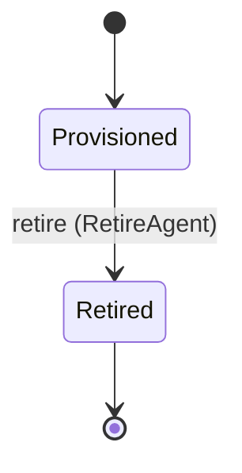

Each move is taken by a declared command outcome, and a move nothing takes is refused as `missing_causation` rather than left as a state change nobody can trigger:

- `retire` — taken by `agency.agents.RetireAgent` on its `retired` outcome

An instance is brought into existence by `agency.agents.ProvisionAgent` on its `provisioned` outcome.

Illegal transitions are illegal by absence: no rule forbids them, there is simply no arrow, because a rule would be a second place for the same truth to live. A diagram cannot show an absence, so the pairs it does not connect are listed here, derived from the same transitions — anything named below is a move this specification does not permit.

- `Retired` may not become `Provisioned`

One view projects it: [`AgentList`](#agentlist).

### `AgentDefinition`

`agency.agents.AgentDefinition`.

An instance is identified by `definition_id`, a `agency.agents.DefinitionId`. The name is part of the model and not a convention: a view projects the identity under that name, so a projection inventing its own would disagree with the view.

It holds:

- `tenant_id` — `agency.auth.TenantId`
- `name` — `String`
- `description` — `String`
- `agent_spec` — `agency.agents.AgentSpecDocument`
- `policy_id` — `agency.auth.PolicyId`
- `version` — `Integer`
- `digest` — `agency.shared.Digest`
- `created_by` — `agency.auth.PrincipalId`
- `check_exit_code` — `Optional<Integer>`, which may be absent
- `check_message` — `Optional<String>`, which may be absent

It references at most one [`agency.auth.Policy`](agency-auth.md#policy), as `policy`, carried by `AgentDefinition.policy_id`. It references at most one [`agency.auth.Principal`](agency-auth.md#principal), as `creator`, carried by `AgentDefinition.created_by`. Its `tenant_id` is what [`agency.auth.Tenant`](agency-auth.md#tenant) owns it by, as `agent_definitions`.

No invariant is declared, so nothing here constrains an instance at rest.

Its state is a `agency.agents.AgentDefinition.State`, one of `Checked`, `Deprecated`, `Draft` and `Published`. That enum is synthesised from the lifecycle rather than declared beside it, so the states a view's filter compares and the states drawn below cannot disagree.

An instance is created in `Draft`. `Deprecated` is terminal, so an instance may rest there forever. That is declared rather than inferred from having no way out: an entity that cannot leave a state is either finished or stuck, and only its author knows which.

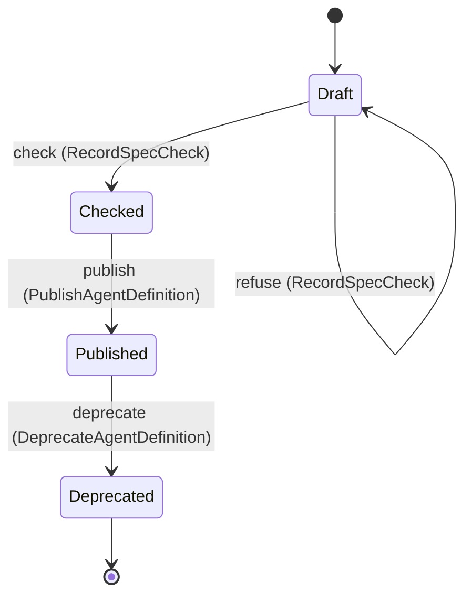

Each move is taken by a declared command outcome, and a move nothing takes is refused as `missing_causation` rather than left as a state change nobody can trigger:

- `check` — taken by `agency.agents.RecordSpecCheck` on its `checked` outcome
- `refuse` — taken by `agency.agents.RecordSpecCheck` on its `refused` outcome
- `publish` — taken by `agency.agents.PublishAgentDefinition` on its `published` outcome
- `deprecate` — taken by `agency.agents.DeprecateAgentDefinition` on its `deprecated` outcome

An instance is brought into existence by `agency.agents.CreateAgentDefinition` on its `created` outcome.

Illegal transitions are illegal by absence: no rule forbids them, there is simply no arrow, because a rule would be a second place for the same truth to live. A diagram cannot show an absence, so the pairs it does not connect are listed here, derived from the same transitions — anything named below is a move this specification does not permit.

- `Checked` may not become `Deprecated`
- `Checked` may not become `Draft`
- `Deprecated` may not become `Checked`
- `Deprecated` may not become `Draft`
- `Deprecated` may not become `Published`
- `Draft` may not become `Deprecated`
- `Draft` may not become `Published`
- `Published` may not become `Checked`
- `Published` may not become `Draft`

Two views project it: [`AgentDefinitionList`](#agentdefinitionlist) and [`agency.auth.EffectivePolicy`](agency-auth.md#effectivepolicy).

## Views

A view is what the outside world is promised it can observe. Each one says which instances it contains and how soon it reflects a command that has already returned, because "you can read this" without "how soon" is the promise every flaky suite is built on.

### `AgentDefinitionList`

`agency.agents.AgentDefinitionList`.

It reads [`AgentDefinition`](#agentdefinition).

It contains every instance of that entity: no filter narrows it, which is a decision somebody made and not a line somebody omitted.

It exposes:

- `definition_id` — `agency.agents.DefinitionId`
- `tenant_id` — `agency.auth.TenantId`
- `name` — `String`
- `description` — `String`
- `agent_spec` — `agency.agents.AgentSpecDocument`
- `policy_id` — `agency.auth.PolicyId`
- `version` — `Integer`
- `digest` — `agency.shared.Digest`
- `created_by` — `agency.auth.PrincipalId`
- `check_exit_code` — `Optional<Integer>`, which may be absent
- `check_message` — `Optional<String>`, which may be absent
- `state` — `agency.agents.AgentDefinition.State`

It declares no order, so the rows come back in whatever order the implementation has, and two reads may disagree.

**Read-your-writes**: it is current the moment the command that changed it returns. A caller that has just created an invoice and cannot see it in here has been told a lie about what it did.

A generated scenario asserts it once, immediately after the command: a view promising this and not keeping the promise has to fail the suite rather than be retried until it passes.

### `AgentList`

`agency.agents.AgentList`.

It reads [`Agent`](#agent).

It contains every instance of that entity: no filter narrows it, which is a decision somebody made and not a line somebody omitted.

It exposes:

- `agent_id` — `agency.agents.AgentId`
- `tenant_id` — `agency.auth.TenantId`
- `definition_id` — `agency.agents.DefinitionId`
- `definition_version` — `Integer`
- `display_name` — `String`
- `principal_id` — `agency.auth.PrincipalId`
- `current_run_id` — `Optional<agency.runs.RunId>`, which may be absent
- `last_seen_at` — `Timestamp`
- `state` — `agency.agents.Agent.State`

It declares no order, so the rows come back in whatever order the implementation has, and two reads may disagree.

**Read-your-writes**: it is current the moment the command that changed it returns. A caller that has just created an invoice and cannot see it in here has been told a lie about what it did.

A generated scenario asserts it once, immediately after the command: a view promising this and not keeping the promise has to fail the suite rather than be retried until it passes.

## Commands

### `CreateAgentDefinition`

`agency.agents.CreateAgentDefinition`, shown to a person as "Create an agent definition".

It takes:

- `tenant_id` — `agency.auth.TenantId`
- `name` — `String`
- `description` — `String`
- `agent_spec` — `agency.agents.AgentSpecDocument`
- `policy_id` — `agency.auth.PolicyId`
- `created_by` — `agency.auth.PrincipalId`

It has one outcome.

**`created`** — The default branch, taken when no other outcome's condition matched. It creates a `agency.agents.AgentDefinition`, which starts in `Draft`. The new instance's identity is published as `definition_id` on `agency.agents.AgentDefinitionCreated`. It emits `agency.agents.AgentDefinitionCreated`. It sets `tenant_id` from `input.tenant_id`, `name` from `input.name`, `description` from `input.description`, `agent_spec` from `input.agent_spec`, `policy_id` from `input.policy_id`, `version` from `implementation-generated`, `digest` from `implementation-generated` and `created_by` from `input.created_by`. A test reaches it by constructing an input that satisfies no other outcome's condition.

### `DeprecateAgentDefinition`

`agency.agents.DeprecateAgentDefinition`, shown to a person as "Deprecate an agent definition".

It takes:

- `definition_id` — `agency.agents.DefinitionId`

It has three outcomes.

**`no-such-definition`** — Taken when the identity the command names is one no record carries, before any other answer for it. No entity in this specification changes. It reports `agency.agents.NotFound`. It emits nothing. A test reaches it by sending an identity no record carries, arranging nothing.

**`deprecated`** — The default branch, taken when no other outcome's condition matched. It moves a `agency.agents.AgentDefinition` from `Published` to `Deprecated`, along the declared move `deprecate`. The instance is the one named by the input field `definition_id`. It emits `agency.agents.AgentDefinitionDeprecated`. A test reaches it by constructing an input that satisfies no other outcome's condition.

**`wrong-state`** — Taken when the subject is resting in a state none of this command's moves start from — a `agency.agents.AgentDefinition` in `Checked`, `Deprecated` and `Draft`, which is what is left of the lifecycle once this command's own moves are taken away. The document lists none of it. No entity in this specification changes. It reports `agency.agents.StateConflict`. It emits nothing. A test reaches it by driving an instance into one of those states and then issuing the command, because no input selects this branch.

### `ProvisionAgent`

`agency.agents.ProvisionAgent`, shown to a person as "Provision an agent".

It takes:

- `tenant_id` — `agency.auth.TenantId`
- `definition_id` — `agency.agents.DefinitionId`
- `definition_version` — `Integer`
- `display_name` — `String`
- `principal_id` — `agency.auth.PrincipalId`

It has one outcome.

**`provisioned`** — The default branch, taken when no other outcome's condition matched. It creates a `agency.agents.Agent`, which starts in `Provisioned`. The new instance's identity is published as `agent_id` on `agency.agents.AgentProvisioned`. It emits `agency.agents.AgentProvisioned`. It sets `tenant_id` from `input.tenant_id`, `definition_id` from `input.definition_id`, `definition_version` from `input.definition_version`, `display_name` from `input.display_name`, `principal_id` from `input.principal_id` and `last_seen_at` from `implementation-generated`. A test reaches it by constructing an input that satisfies no other outcome's condition.

### `PublishAgentDefinition`

`agency.agents.PublishAgentDefinition`, shown to a person as "Publish an agent definition".

It takes:

- `definition_id` — `agency.agents.DefinitionId`

It has three outcomes.

**`no-such-definition`** — Taken when the identity the command names is one no record carries, before any other answer for it. No entity in this specification changes. It reports `agency.agents.NotFound`. It emits nothing. A test reaches it by sending an identity no record carries, arranging nothing.

**`published`** — The default branch, taken when no other outcome's condition matched. It moves a `agency.agents.AgentDefinition` from `Checked` to `Published`, along the declared move `publish`. The instance is the one named by the input field `definition_id`. It emits `agency.agents.AgentDefinitionPublished`. A test reaches it by constructing an input that satisfies no other outcome's condition.

**`wrong-state`** — Taken when the subject is resting in a state none of this command's moves start from — a `agency.agents.AgentDefinition` in `Deprecated`, `Draft` and `Published`, which is what is left of the lifecycle once this command's own moves are taken away. The document lists none of it. No entity in this specification changes. It reports `agency.agents.StateConflict`. It emits nothing. A test reaches it by driving an instance into one of those states and then issuing the command, because no input selects this branch.

### `RecordSpecCheck`

`agency.agents.RecordSpecCheck`, shown to a person as "Record Loom's check of a definition's document".

It takes:

- `definition_id` — `agency.agents.DefinitionId`
- `exit_code` — `Integer`
- `verdict` — `agency.agents.CheckVerdict`
- `message` — `String`

It has four outcomes.

**`no-such-definition`** — Taken when the identity the command names is one no record carries, before any other answer for it. No entity in this specification changes. It reports `agency.agents.NotFound`. It emits nothing. A test reaches it by sending an identity no record carries, arranging nothing.

**`refused`** — Taken when `verdict == Refused` holds of the input. It moves a `agency.agents.AgentDefinition` from `Draft` to `Draft`, along the declared move `refuse`. The instance is the one named by the input field `definition_id`. It emits `agency.agents.AgentSpecRefused`. It sets `check_exit_code` from `input.exit_code` and `check_message` from `input.message`. A test reaches it by constructing an input that satisfies that condition.

**`checked`** — Taken when `verdict == Accepted` holds of the input. It moves a `agency.agents.AgentDefinition` from `Draft` to `Checked`, along the declared move `check`. The instance is the one named by the input field `definition_id`. It emits `agency.agents.AgentSpecChecked`. It sets `check_exit_code` from `input.exit_code` and `check_message` from `input.message`. A test reaches it by constructing an input that satisfies that condition.

**`wrong-state`** — Taken when the subject is resting in a state none of this command's moves start from — a `agency.agents.AgentDefinition` in `Checked`, `Deprecated` and `Published`, which is what is left of the lifecycle once this command's own moves are taken away. The document lists none of it. No entity in this specification changes. It reports `agency.agents.StateConflict`. It emits nothing. A test reaches it by driving an instance into one of those states and then issuing the command, because no input selects this branch.

### `RetireAgent`

`agency.agents.RetireAgent`, shown to a person as "Retire an agent".

It takes:

- `agent_id` — `agency.agents.AgentId`

It has three outcomes.

**`no-such-agent`** — Taken when the identity the command names is one no record carries, before any other answer for it. No entity in this specification changes. It reports `agency.agents.NotFound`. It emits nothing. A test reaches it by sending an identity no record carries, arranging nothing.

**`retired`** — The default branch, taken when no other outcome's condition matched. It moves a `agency.agents.Agent` from `Provisioned` to `Retired`, along the declared move `retire`. The instance is the one named by the input field `agent_id`. It emits `agency.agents.AgentRetired`. A test reaches it by constructing an input that satisfies no other outcome's condition.

**`wrong-state`** — Taken when the subject is resting in a state none of this command's moves start from — a `agency.agents.Agent` in `Retired`, which is what is left of the lifecycle once this command's own moves are taken away. The document lists none of it. No entity in this specification changes. It reports `agency.agents.StateConflict`. It emits nothing. A test reaches it by driving an instance into one of those states and then issuing the command, because no input selects this branch.

## Events

### `AgentDefinitionCreated`

`agency.agents.AgentDefinitionCreated`.

It carries:

- `definition_id` — `agency.agents.DefinitionId`
- `name` — `String`

Emitted by `agency.agents.CreateAgentDefinition` on its `created` outcome.

Nothing in this system reacts to it.

### `AgentDefinitionDeprecated`

`agency.agents.AgentDefinitionDeprecated`.

It carries:

- `definition_id` — `agency.agents.DefinitionId`

Emitted by `agency.agents.DeprecateAgentDefinition` on its `deprecated` outcome.

Nothing in this system reacts to it.

### `AgentDefinitionPublished`

`agency.agents.AgentDefinitionPublished`.

It carries:

- `definition_id` — `agency.agents.DefinitionId`

Emitted by `agency.agents.PublishAgentDefinition` on its `published` outcome.

Nothing in this system reacts to it.

### `AgentProvisioned`

`agency.agents.AgentProvisioned`.

It carries:

- `agent_id` — `agency.agents.AgentId`
- `definition_id` — `agency.agents.DefinitionId`
- `definition_version` — `Integer`

Emitted by `agency.agents.ProvisionAgent` on its `provisioned` outcome.

Nothing in this system reacts to it.

### `AgentRetired`

`agency.agents.AgentRetired`.

It carries:

- `agent_id` — `agency.agents.AgentId`

Emitted by `agency.agents.RetireAgent` on its `retired` outcome.

Nothing in this system reacts to it.

### `AgentSpecChecked`

`agency.agents.AgentSpecChecked`.

It carries:

- `definition_id` — `agency.agents.DefinitionId`
- `message` — `String`

Emitted by `agency.agents.RecordSpecCheck` on its `checked` outcome.

Nothing in this system reacts to it.

### `AgentSpecRefused`

`agency.agents.AgentSpecRefused`.

It carries:

- `definition_id` — `agency.agents.DefinitionId`
- `exit_code` — `Integer`
- `message` — `String`

Emitted by `agency.agents.RecordSpecCheck` on its `refused` outcome.

Nothing in this system reacts to it.

## Errors

### `NotFound`

The addressed record does not exist, and nothing changed.

It carries nothing beyond its name, so a caller can tell what went wrong and not which value caused it.

Reported by `agency.agents.DeprecateAgentDefinition` on its `no-such-definition` outcome.

Reported by `agency.agents.PublishAgentDefinition` on its `no-such-definition` outcome.

Reported by `agency.agents.RecordSpecCheck` on its `no-such-definition` outcome.

Reported by `agency.agents.RetireAgent` on its `no-such-agent` outcome.

### `StateConflict`

The addressed record is not in a state this command acts from, and nothing changed.

It carries nothing beyond its name, so a caller can tell what went wrong and not which value caused it.

Reported by `agency.agents.DeprecateAgentDefinition` on its `wrong-state` outcome.

Reported by `agency.agents.PublishAgentDefinition` on its `wrong-state` outcome.

Reported by `agency.agents.RecordSpecCheck` on its `wrong-state` outcome.

Reported by `agency.agents.RetireAgent` on its `wrong-state` outcome.

## Actors

An actor is who may ask this context for something. Every grant below points at a command this specification declares — a grant is a resolved reference, so "may invoke" something nobody wrote is not a permission this model can express, and an authorisation that authorises nothing cannot ship quietly.

### `SpecChecker`

`agency.agents.SpecChecker`.

It may invoke [`RecordSpecCheck`](#recordspeccheck).

---

Generated from agency v1 · model digest `71132e90bde806415603d08bb97a71629b2c2f6cda30e1f22e76f407abd9a3eb` · contract digest `slice-sha256/2:93c749177681f8c9cbb4c2724ab13d7f7bf7cb15435606227d8b973298be15a9`. Do not edit this file; change the specification and regenerate it with `ess generate`.

<!--
generated from agency v1
model digest 71132e90bde806415603d08bb97a71629b2c2f6cda30e1f22e76f407abd9a3eb
contract digest slice-sha256/2:4de837b1c07fda95d5800e7946244fdece9772258e1a7e9712c0589e5036fa9b
do not edit: regenerate with `ess generate`
-->

# Auth

Who may act in Agency and with what: tenants, principals and their roles, credentials held as custody pointers, grants of those credentials, and the policies runs are sealed under.

`agency.auth` is one of agency's bounded contexts. [Back to the index](../index.md).

## Types

### `ConnectorsCustody`

`agency.auth.ConnectorsCustody` is a record of one field:

- `instance_id` — `String`

### `CredentialId`

`agency.auth.CredentialId` wraps `Uuid` and is not interchangeable with one: the whole value of naming it separately is the crossings the model then refuses.

### `CredentialKind`

`agency.auth.CredentialKind` is one of `OperatorLogin`, `ApiKey`, `OAuthToken` and `ConnectorInstance`.

### `CredentialScope`

`agency.auth.CredentialScope` is a record of three fields:

- `models` — `List<String>`
- `providers` — `List<String>`
- `tools` — `List<agency.tools.ToolId>`

### `Custody`

`agency.auth.Custody` is one of three shapes, told apart by a `kind` field — tagged, so a decoder never has to guess which branch it is reading:

- `AgencyVault` — carries nothing; its value is the tag alone
- `ConnectorsInstance` — `agency.auth.ConnectorsCustody`
- `HostFile` — `agency.auth.HostFileCustody`

### `DecisionMode`

`agency.auth.DecisionMode` is one of `Frame`, `Ask` and `Observe`.

### `DefinitionSubject`

`agency.auth.DefinitionSubject` is a record of one field:

- `definition_id` — `agency.agents.DefinitionId`

### `GrantId`

`agency.auth.GrantId` wraps `Uuid` and is not interchangeable with one: the whole value of naming it separately is the crossings the model then refuses.

### `GrantPurpose`

`agency.auth.GrantPurpose` is one of two shapes, told apart by a `kind` field — tagged, so a decoder never has to guess which branch it is reading:

- `ModelCalls` — carries nothing; its value is the tag alone
- `ToolCalls` — `agency.auth.ToolCallsPurpose`

### `HostFileCustody`

`agency.auth.HostFileCustody` is a record of one field:

- `path` — `String`

### `PolicyId`

`agency.auth.PolicyId` wraps `Uuid` and is not interchangeable with one: the whole value of naming it separately is the crossings the model then refuses.

### `PrincipalId`

`agency.auth.PrincipalId` wraps `Uuid` and is not interchangeable with one: the whole value of naming it separately is the crossings the model then refuses.

### `PrincipalKind`

`agency.auth.PrincipalKind` is one of `Human`, `Agent` and `Service`.

### `RiskCeiling`

`agency.auth.RiskCeiling` is one of `Low`, `Medium` and `High`.

### `Role`

`agency.auth.Role` is one of `Operator`, `Supervisor`, `Viewer` and `Agent`.

### `Rule`

`agency.auth.Rule` is a record of seven fields:

- `subject` — `agency.auth.RuleSubject`
- `tool_id` — `Optional<agency.tools.ToolId>`, which may be absent
- `verbs` — `Optional<List<agency.shared.Verb>>`, which may be absent
- `risk_ceiling` — `agency.auth.RiskCeiling`
- `decision_mode` — `agency.auth.DecisionMode`
- `budget_ceiling` — `agency.shared.RunBudget`
- `hermetic` — `Boolean`

### `RuleSubject`

`agency.auth.RuleSubject` is one of four shapes, told apart by a `kind` field — tagged, so a decoder never has to guess which branch it is reading:

- `Definition` — `agency.auth.DefinitionSubject`
- `Team` — `agency.auth.TeamSubject`
- `Tenant` — `agency.auth.TenantSubject`
- `Workforce` — `agency.auth.WorkforceSubject`

### `TeamSubject`

`agency.auth.TeamSubject` is a record of one field:

- `team_id` — `agency.teams.TeamId`

### `TenantId`

`agency.auth.TenantId` wraps `Uuid` and is not interchangeable with one: the whole value of naming it separately is the crossings the model then refuses.

### `TenantSubject`

`agency.auth.TenantSubject` is a record of one field:

- `tenant_id` — `agency.auth.TenantId`

### `ToolCallsPurpose`

`agency.auth.ToolCallsPurpose` is a record of one field:

- `tool_id` — `agency.tools.ToolId`

### `WorkforceSubject`

`agency.auth.WorkforceSubject` is a record of one field:

- `workforce_id` — `agency.teams.WorkforceId`

## Entities

An entity is what this context is about: something with an identity that outlives any one request, a shape, and a lifecycle. The lifecycle is exhaustive — a move that is not drawn below is a move this specification does not permit, and that is the only way it says so. Every move is labelled with the command that takes it, because a move nothing can trigger is refused rather than drawn.

### `Credential`

`agency.auth.Credential`.

An instance is identified by `credential_id`, a `agency.auth.CredentialId`. The name is part of the model and not a convention: a view projects the identity under that name, so a projection inventing its own would disagree with the view.

It holds:

- `tenant_id` — `agency.auth.TenantId`
- `kind` — `agency.auth.CredentialKind`
- `custody` — `agency.auth.Custody`
- `scope` — `agency.auth.CredentialScope`
- `owner_principal_id` — `agency.auth.PrincipalId`
- `expires_at` — `Optional<Timestamp>`, which may be absent
- `last_refreshed_at` — `Timestamp`

It references at most one [`Principal`](#principal), as `owner`, carried by `Credential.owner_principal_id`. Its `tenant_id` is what [`Tenant`](#tenant) owns it by, as `credentials`.

No invariant is declared, so nothing here constrains an instance at rest.

Its state is a `agency.auth.Credential.State`, one of `Revoked` and `Stored`. That enum is synthesised from the lifecycle rather than declared beside it, so the states a view's filter compares and the states drawn below cannot disagree.

An instance is created in `Stored`. `Revoked` is terminal, so an instance may rest there forever. That is declared rather than inferred from having no way out: an entity that cannot leave a state is either finished or stuck, and only its author knows which.

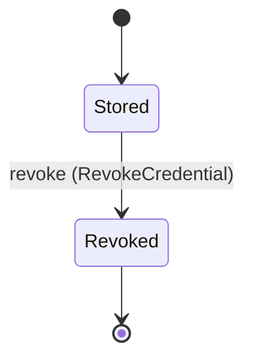

Each move is taken by a declared command outcome, and a move nothing takes is refused as `missing_causation` rather than left as a state change nobody can trigger:

- `revoke` — taken by `agency.auth.RevokeCredential` on its `revoked` outcome

An instance is brought into existence by `agency.auth.StoreCredential` on its `stored` outcome.

Illegal transitions are illegal by absence: no rule forbids them, there is simply no arrow, because a rule would be a second place for the same truth to live. A diagram cannot show an absence, so the pairs it does not connect are listed here, derived from the same transitions — anything named below is a move this specification does not permit.

- `Revoked` may not become `Stored`

One view projects it: [`CredentialList`](#credentiallist).

### `CredentialGrant`

`agency.auth.CredentialGrant`.

An instance is identified by `grant_id`, a `agency.auth.GrantId`. The name is part of the model and not a convention: a view projects the identity under that name, so a projection inventing its own would disagree with the view.

It holds:

- `tenant_id` — `agency.auth.TenantId`
- `credential_id` — `agency.auth.CredentialId`
- `grantee_agent_id` — `Optional<agency.agents.AgentId>`, which may be absent
- `grantee_team_id` — `Optional<agency.teams.TeamId>`, which may be absent
- `grantee_workforce_id` — `Optional<agency.teams.WorkforceId>`, which may be absent
- `purpose` — `agency.auth.GrantPurpose`
- `expires_at` — `Optional<Timestamp>`, which may be absent

It references at most one [`Credential`](#credential), as `credential`, carried by `CredentialGrant.credential_id`. It references at most one [`agency.agents.Agent`](agency-agents.md#agent), as `grantee_agent`, carried by `CredentialGrant.grantee_agent_id`. It references at most one [`agency.teams.Team`](agency-teams.md#team), as `grantee_team`, carried by `CredentialGrant.grantee_team_id`. It references at most one [`agency.teams.Workforce`](agency-teams.md#workforce), as `grantee_workforce`, carried by `CredentialGrant.grantee_workforce_id`. Its `tenant_id` is what [`Tenant`](#tenant) owns it by, as `credential_grants`.

Every instance satisfies `((defined(grantee_agent_id) and not (defined(grantee_team_id)) and not (defined(grantee_workforce_id))) or (not (defined(grantee_agent_id)) and defined(grantee_team_id) and not (defined(grantee_workforce_id))) or (not (defined(grantee_agent_id)) and not (defined(grantee_team_id)) and defined(grantee_workforce_id)))` — a predicate over this entity's own fields, checked against them rather than stored as a sentence, so an invariant reading something the entity does not have is refused instead of documented.

Its state is a `agency.auth.CredentialGrant.State`, one of `Granted` and `Revoked`. That enum is synthesised from the lifecycle rather than declared beside it, so the states a view's filter compares and the states drawn below cannot disagree.

An instance is created in `Granted`. `Revoked` is terminal, so an instance may rest there forever. That is declared rather than inferred from having no way out: an entity that cannot leave a state is either finished or stuck, and only its author knows which.

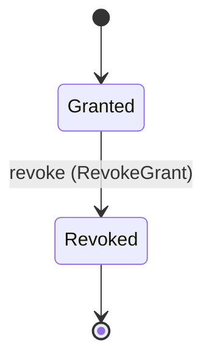

Each move is taken by a declared command outcome, and a move nothing takes is refused as `missing_causation` rather than left as a state change nobody can trigger:

- `revoke` — taken by `agency.auth.RevokeGrant` on its `revoked` outcome

An instance is brought into existence by `agency.auth.GrantCredential` on its `granted-to-agent` outcome, `agency.auth.GrantCredential` on its `granted-to-team` outcome and `agency.auth.GrantCredential` on its `granted-to-workforce` outcome.

Illegal transitions are illegal by absence: no rule forbids them, there is simply no arrow, because a rule would be a second place for the same truth to live. A diagram cannot show an absence, so the pairs it does not connect are listed here, derived from the same transitions — anything named below is a move this specification does not permit.

- `Revoked` may not become `Granted`

One view projects it: [`GrantMatrix`](#grantmatrix).

### `Policy`

`agency.auth.Policy`.

An instance is identified by `policy_id`, a `agency.auth.PolicyId`. The name is part of the model and not a convention: a view projects the identity under that name, so a projection inventing its own would disagree with the view.

It holds:

- `tenant_id` — `agency.auth.TenantId`
- `name` — `String`
- `rules` — `List<agency.auth.Rule>`
- `version` — `Integer`
- `digest` — `agency.shared.Digest`

Its `tenant_id` is what [`Tenant`](#tenant) owns it by, as `policies`.

No invariant is declared, so nothing here constrains an instance at rest.

Its state is a `agency.auth.Policy.State`, one of `Active`, `Draft` and `Superseded`. That enum is synthesised from the lifecycle rather than declared beside it, so the states a view's filter compares and the states drawn below cannot disagree.

An instance is created in `Draft`. `Superseded` is terminal, so an instance may rest there forever. That is declared rather than inferred from having no way out: an entity that cannot leave a state is either finished or stuck, and only its author knows which.

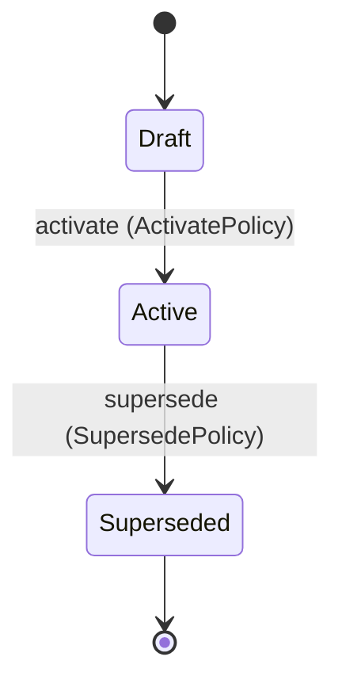

Each move is taken by a declared command outcome, and a move nothing takes is refused as `missing_causation` rather than left as a state change nobody can trigger:

- `activate` — taken by `agency.auth.ActivatePolicy` on its `activated` outcome
- `supersede` — taken by `agency.auth.SupersedePolicy` on its `superseded` outcome

An instance is brought into existence by `agency.auth.CreatePolicy` on its `created` outcome.

Illegal transitions are illegal by absence: no rule forbids them, there is simply no arrow, because a rule would be a second place for the same truth to live. A diagram cannot show an absence, so the pairs it does not connect are listed here, derived from the same transitions — anything named below is a move this specification does not permit.

- `Active` may not become `Draft`
- `Draft` may not become `Superseded`
- `Superseded` may not become `Active`
- `Superseded` may not become `Draft`

One view projects it: [`PolicyList`](#policylist).

### `Principal`

`agency.auth.Principal`.

An instance is identified by `principal_id`, a `agency.auth.PrincipalId`. The name is part of the model and not a convention: a view projects the identity under that name, so a projection inventing its own would disagree with the view.

It holds:

- `tenant_id` — `agency.auth.TenantId`
- `kind` — `agency.auth.PrincipalKind`
- `subject` — `String`
- `roles` — `List<agency.auth.Role>`
- `mandate_ref` — `Optional<String>`, which may be absent

Its `tenant_id` is what [`Tenant`](#tenant) owns it by, as `principals`.

No invariant is declared, so nothing here constrains an instance at rest.

Its state is a `agency.auth.Principal.State`, one of `Disabled` and `Invited`. That enum is synthesised from the lifecycle rather than declared beside it, so the states a view's filter compares and the states drawn below cannot disagree.

An instance is created in `Invited`. `Disabled` is terminal, so an instance may rest there forever. That is declared rather than inferred from having no way out: an entity that cannot leave a state is either finished or stuck, and only its author knows which.

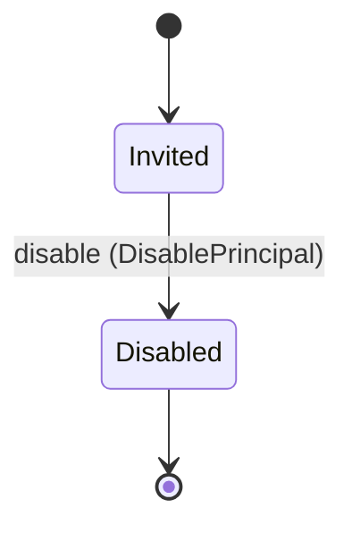

Each move is taken by a declared command outcome, and a move nothing takes is refused as `missing_causation` rather than left as a state change nobody can trigger:

- `disable` — taken by `agency.auth.DisablePrincipal` on its `disabled` outcome

An instance is brought into existence by `agency.auth.InvitePrincipal` on its `invited` outcome.

Illegal transitions are illegal by absence: no rule forbids them, there is simply no arrow, because a rule would be a second place for the same truth to live. A diagram cannot show an absence, so the pairs it does not connect are listed here, derived from the same transitions — anything named below is a move this specification does not permit.

- `Disabled` may not become `Invited`

One view projects it: [`PrincipalList`](#principallist).

### `Tenant`

`agency.auth.Tenant`.

An instance is identified by `tenant_id`, a `agency.auth.TenantId`. The name is part of the model and not a convention: a view projects the identity under that name, so a projection inventing its own would disagree with the view.

It holds:

- `name` — `String`
- `mandate_tenant_ref` — `Optional<String>`, which may be absent

It owns any number of [`agency.agents.AgentDefinition`](agency-agents.md#agentdefinition), as `agent_definitions`, carried by `agency.agents.AgentDefinition.tenant_id`. It owns any number of [`agency.agents.Agent`](agency-agents.md#agent), as `agents`, carried by `agency.agents.Agent.tenant_id`. It owns any number of [`agency.runs.Run`](agency-runs.md#run), as `runs`, carried by `agency.runs.Run.tenant_id`. It owns any number of [`agency.tools.Tool`](agency-tools.md#tool), as `tools`, carried by `agency.tools.Tool.tenant_id`. It owns any number of [`agency.tools.ToolBinding`](agency-tools.md#toolbinding), as `tool_bindings`, carried by `agency.tools.ToolBinding.tenant_id`. It owns any number of [`agency.teams.Team`](agency-teams.md#team), as `teams`, carried by `agency.teams.Team.tenant_id`. It owns any number of [`agency.teams.Swarm`](agency-teams.md#swarm), as `swarms`, carried by `agency.teams.Swarm.tenant_id`. It owns any number of [`agency.teams.Workforce`](agency-teams.md#workforce), as `workforces`, carried by `agency.teams.Workforce.tenant_id`. It owns any number of [`agency.work.WorkInput`](agency-work.md#workinput), as `work_inputs`, carried by `agency.work.WorkInput.tenant_id`. It owns any number of [`agency.work.WorkItem`](agency-work.md#workitem), as `work_items`, carried by `agency.work.WorkItem.tenant_id`. It owns any number of [`Principal`](#principal), as `principals`, carried by `Principal.tenant_id`. It owns any number of [`Credential`](#credential), as `credentials`, carried by `Credential.tenant_id`. It owns any number of [`CredentialGrant`](#credentialgrant), as `credential_grants`, carried by `CredentialGrant.tenant_id`. It owns any number of [`Policy`](#policy), as `policies`, carried by `Policy.tenant_id`.

No invariant is declared, so nothing here constrains an instance at rest.

Its state is a `agency.auth.Tenant.State`, one of `Created`. That enum is synthesised from the lifecycle rather than declared beside it, so the states a view's filter compares and the states drawn below cannot disagree.

An instance is created in `Created`. `Created` is terminal, so an instance may rest there forever. That is declared rather than inferred from having no way out: an entity that cannot leave a state is either finished or stuck, and only its author knows which.

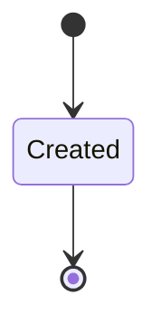

It declares no moves, so nothing changes its state once it exists.

It has one state, so there is no move to permit or to forbid.

No view projects it, so nothing outside this context is promised a way to observe one.

## Views

A view is what the outside world is promised it can observe. Each one says which instances it contains and how soon it reflects a command that has already returned, because "you can read this" without "how soon" is the promise every flaky suite is built on.

### `CredentialList`

`agency.auth.CredentialList`.

It reads [`Credential`](#credential).

It contains every instance of that entity: no filter narrows it, which is a decision somebody made and not a line somebody omitted.

It exposes:

- `credential_id` — `agency.auth.CredentialId`
- `tenant_id` — `agency.auth.TenantId`
- `kind` — `agency.auth.CredentialKind`
- `custody` — `agency.auth.Custody`
- `scope` — `agency.auth.CredentialScope`
- `owner_principal_id` — `agency.auth.PrincipalId`
- `expires_at` — `Optional<Timestamp>`, which may be absent
- `last_refreshed_at` — `Timestamp`
- `state` — `agency.auth.Credential.State`

It declares no order, so the rows come back in whatever order the implementation has, and two reads may disagree.

**Read-your-writes**: it is current the moment the command that changed it returns. A caller that has just created an invoice and cannot see it in here has been told a lie about what it did.

A generated scenario asserts it once, immediately after the command: a view promising this and not keeping the promise has to fail the suite rather than be retried until it passes.

### `EffectivePolicy`

`agency.auth.EffectivePolicy`.

It reads [`agency.agents.AgentDefinition`](agency-agents.md#agentdefinition).

It contains the instances where `definition_id == param.definition_id` holds, and only those — so an instance a caller cannot find in here has been filtered out rather than lost.

It exposes:

- `definition_id` — `agency.agents.DefinitionId`
- `policy_id` — `agency.auth.PolicyId`
- `policy_version` — `Optional<Integer>`, which may be absent
- `policy_digest` — `Optional<agency.shared.Digest>`, which may be absent
- `rules` — `Optional<List<agency.auth.Rule>>`, which may be absent
- `policy_state` — `Optional<agency.auth.Policy.State>`, which may be absent

It declares no order, so the rows come back in whatever order the implementation has, and two reads may disagree.

**Read-your-writes**: it is current the moment the command that changed it returns. A caller that has just created an invoice and cannot see it in here has been told a lie about what it did.

A generated scenario asserts it once, immediately after the command: a view promising this and not keeping the promise has to fail the suite rather than be retried until it passes.

### `GrantMatrix`

`agency.auth.GrantMatrix`.

It reads [`CredentialGrant`](#credentialgrant).

It contains every instance of that entity: no filter narrows it, which is a decision somebody made and not a line somebody omitted.

It exposes:

- `grant_id` — `agency.auth.GrantId`
- `tenant_id` — `agency.auth.TenantId`
- `credential_id` — `agency.auth.CredentialId`
- `grantee_agent_id` — `Optional<agency.agents.AgentId>`, which may be absent
- `grantee_team_id` — `Optional<agency.teams.TeamId>`, which may be absent
- `grantee_workforce_id` — `Optional<agency.teams.WorkforceId>`, which may be absent
- `purpose` — `agency.auth.GrantPurpose`
- `expires_at` — `Optional<Timestamp>`, which may be absent
- `state` — `agency.auth.CredentialGrant.State`

It declares no order, so the rows come back in whatever order the implementation has, and two reads may disagree.

**Read-your-writes**: it is current the moment the command that changed it returns. A caller that has just created an invoice and cannot see it in here has been told a lie about what it did.

A generated scenario asserts it once, immediately after the command: a view promising this and not keeping the promise has to fail the suite rather than be retried until it passes.

### `PolicyList`

`agency.auth.PolicyList`.

It reads [`Policy`](#policy).

It contains every instance of that entity: no filter narrows it, which is a decision somebody made and not a line somebody omitted.

It exposes:

- `policy_id` — `agency.auth.PolicyId`
- `tenant_id` — `agency.auth.TenantId`
- `name` — `String`
- `rules` — `List<agency.auth.Rule>`
- `version` — `Integer`
- `digest` — `agency.shared.Digest`
- `state` — `agency.auth.Policy.State`

It declares no order, so the rows come back in whatever order the implementation has, and two reads may disagree.

**Read-your-writes**: it is current the moment the command that changed it returns. A caller that has just created an invoice and cannot see it in here has been told a lie about what it did.

A generated scenario asserts it once, immediately after the command: a view promising this and not keeping the promise has to fail the suite rather than be retried until it passes.

### `PrincipalList`

`agency.auth.PrincipalList`.

It reads [`Principal`](#principal).

It contains every instance of that entity: no filter narrows it, which is a decision somebody made and not a line somebody omitted.

It exposes:

- `principal_id` — `agency.auth.PrincipalId`
- `tenant_id` — `agency.auth.TenantId`
- `kind` — `agency.auth.PrincipalKind`
- `subject` — `String`
- `roles` — `List<agency.auth.Role>`
- `mandate_ref` — `Optional<String>`, which may be absent
- `state` — `agency.auth.Principal.State`

It declares no order, so the rows come back in whatever order the implementation has, and two reads may disagree.

**Read-your-writes**: it is current the moment the command that changed it returns. A caller that has just created an invoice and cannot see it in here has been told a lie about what it did.

A generated scenario asserts it once, immediately after the command: a view promising this and not keeping the promise has to fail the suite rather than be retried until it passes.

## Commands

### `ActivatePolicy`

`agency.auth.ActivatePolicy`, shown to a person as "Activate a policy".

It takes:

- `policy_id` — `agency.auth.PolicyId`

It has three outcomes.

**`no-such-policy`** — Taken when the identity the command names is one no record carries, before any other answer for it. No entity in this specification changes. It reports `agency.auth.NotFound`. It emits nothing. A test reaches it by sending an identity no record carries, arranging nothing.

**`activated`** — The default branch, taken when no other outcome's condition matched. It moves a `agency.auth.Policy` from `Draft` to `Active`, along the declared move `activate`. The instance is the one named by the input field `policy_id`. It emits `agency.auth.PolicyActivated`. A test reaches it by constructing an input that satisfies no other outcome's condition.

**`wrong-state`** — Taken when the subject is resting in a state none of this command's moves start from — a `agency.auth.Policy` in `Active` and `Superseded`, which is what is left of the lifecycle once this command's own moves are taken away. The document lists none of it. No entity in this specification changes. It reports `agency.auth.StateConflict`. It emits nothing. A test reaches it by driving an instance into one of those states and then issuing the command, because no input selects this branch.

### `AssignRole`

`agency.auth.AssignRole`, shown to a person as "Assign a role".

It takes:

- `principal_id` — `agency.auth.PrincipalId`
- `role` — `agency.auth.Role`

It has two outcomes.

**`no-such-principal`** — Taken when the identity the command names is one no record carries, before any other answer for it. No entity in this specification changes. It reports `agency.auth.NotFound`. It emits nothing. A test reaches it by sending an identity no record carries, arranging nothing.

**`assigned`** — The default branch, taken when no other outcome's condition matched. It changes a `agency.auth.Principal` without moving it along its lifecycle. The instance is the one named by the input field `principal_id`. It emits `agency.auth.RoleAssigned`. It sets `roles` from `its previous list, absent read as empty, with input.role last`. A test reaches it by constructing an input that satisfies no other outcome's condition.

### `CreatePolicy`

`agency.auth.CreatePolicy`, shown to a person as "Create a policy".

It takes:

- `tenant_id` — `agency.auth.TenantId`
- `name` — `String`
- `rules` — `List<agency.auth.Rule>`

It has one outcome.

**`created`** — The default branch, taken when no other outcome's condition matched. It creates a `agency.auth.Policy`, which starts in `Draft`. The new instance's identity is published as `policy_id` on `agency.auth.PolicyCreated`. It emits `agency.auth.PolicyCreated`. It sets `tenant_id` from `input.tenant_id`, `name` from `input.name`, `rules` from `input.rules`, `version` from `implementation-generated` and `digest` from `implementation-generated`. A test reaches it by constructing an input that satisfies no other outcome's condition.

### `CreateTenant`

`agency.auth.CreateTenant`, shown to a person as "Create a tenant".

It takes:

- `name` — `String`
- `mandate_tenant_ref` — `Optional<String>`, which may be absent

It has one outcome.

**`created`** — The default branch, taken when no other outcome's condition matched. It creates a `agency.auth.Tenant`, which starts in `Created`. The new instance's identity is published as `tenant_id` on `agency.auth.TenantCreated`. It emits `agency.auth.TenantCreated`. It sets `name` from `input.name` and `mandate_tenant_ref` from `input.mandate_tenant_ref`. A test reaches it by constructing an input that satisfies no other outcome's condition.

### `DisablePrincipal`

`agency.auth.DisablePrincipal`, shown to a person as "Disable a principal".

It takes:

- `principal_id` — `agency.auth.PrincipalId`

It has three outcomes.

**`no-such-principal`** — Taken when the identity the command names is one no record carries, before any other answer for it. No entity in this specification changes. It reports `agency.auth.NotFound`. It emits nothing. A test reaches it by sending an identity no record carries, arranging nothing.

**`disabled`** — The default branch, taken when no other outcome's condition matched. It moves a `agency.auth.Principal` from `Invited` to `Disabled`, along the declared move `disable`. The instance is the one named by the input field `principal_id`. It emits `agency.auth.PrincipalDisabled`. A test reaches it by constructing an input that satisfies no other outcome's condition.

**`wrong-state`** — Taken when the subject is resting in a state none of this command's moves start from — a `agency.auth.Principal` in `Disabled`, which is what is left of the lifecycle once this command's own moves are taken away. The document lists none of it. No entity in this specification changes. It reports `agency.auth.StateConflict`. It emits nothing. A test reaches it by driving an instance into one of those states and then issuing the command, because no input selects this branch.

### `GrantCredential`

`agency.auth.GrantCredential`, shown to a person as "Grant a credential".

It takes:

- `tenant_id` — `agency.auth.TenantId`
- `credential_id` — `agency.auth.CredentialId`
- `grantee_agent_id` — `Optional<agency.agents.AgentId>`, which may be absent
- `grantee_team_id` — `Optional<agency.teams.TeamId>`, which may be absent
- `grantee_workforce_id` — `Optional<agency.teams.WorkforceId>`, which may be absent
- `purpose` — `agency.auth.GrantPurpose`
- `expires_at` — `Optional<Timestamp>`, which may be absent

It has four outcomes.

**`granted-to-agent`** — Taken when `(defined(grantee_agent_id) and not (defined(grantee_team_id)) and not (defined(grantee_workforce_id)))` holds of the input. It creates a `agency.auth.CredentialGrant`, which starts in `Granted`. The new instance's identity is published as `grant_id` on `agency.auth.CredentialGranted`. It emits `agency.auth.CredentialGranted`. It sets `tenant_id` from `input.tenant_id`, `credential_id` from `input.credential_id`, `grantee_agent_id` from `input.grantee_agent_id`, `purpose` from `input.purpose` and `expires_at` from `input.expires_at`. A test reaches it by constructing an input that satisfies that condition.

**`granted-to-team`** — Taken when `(not (defined(grantee_agent_id)) and defined(grantee_team_id) and not (defined(grantee_workforce_id)))` holds of the input. It creates a `agency.auth.CredentialGrant`, which starts in `Granted`. The new instance's identity is published as `grant_id` on `agency.auth.CredentialGranted`. It emits `agency.auth.CredentialGranted`. It sets `tenant_id` from `input.tenant_id`, `credential_id` from `input.credential_id`, `grantee_team_id` from `input.grantee_team_id`, `purpose` from `input.purpose` and `expires_at` from `input.expires_at`. A test reaches it by constructing an input that satisfies that condition.

**`granted-to-workforce`** — Taken when `(not (defined(grantee_agent_id)) and not (defined(grantee_team_id)) and defined(grantee_workforce_id))` holds of the input. It creates a `agency.auth.CredentialGrant`, which starts in `Granted`. The new instance's identity is published as `grant_id` on `agency.auth.CredentialGranted`. It emits `agency.auth.CredentialGranted`. It sets `tenant_id` from `input.tenant_id`, `credential_id` from `input.credential_id`, `grantee_workforce_id` from `input.grantee_workforce_id`, `purpose` from `input.purpose` and `expires_at` from `input.expires_at`. A test reaches it by constructing an input that satisfies that condition.

**`grantee-invalid`** — The default branch, taken when no other outcome's condition matched. No entity in this specification changes. It reports `agency.auth.GranteeInvalid`. It emits nothing. A test reaches it by constructing an input that satisfies no other outcome's condition.

### `InvitePrincipal`

`agency.auth.InvitePrincipal`, shown to a person as "Invite a principal".

It takes:

- `tenant_id` — `agency.auth.TenantId`
- `kind` — `agency.auth.PrincipalKind`
- `subject` — `String`
- `roles` — `List<agency.auth.Role>`
- `mandate_ref` — `Optional<String>`, which may be absent

It has one outcome.

**`invited`** — The default branch, taken when no other outcome's condition matched. It creates a `agency.auth.Principal`, which starts in `Invited`. The new instance's identity is published as `principal_id` on `agency.auth.PrincipalInvited`. It emits `agency.auth.PrincipalInvited`. It sets `tenant_id` from `input.tenant_id`, `kind` from `input.kind`, `subject` from `input.subject`, `roles` from `input.roles` and `mandate_ref` from `input.mandate_ref`. A test reaches it by constructing an input that satisfies no other outcome's condition.

### `RefreshCredential`

`agency.auth.RefreshCredential`, shown to a person as "Refresh a credential".

It takes:

- `credential_id` — `agency.auth.CredentialId`

It has three outcomes.

**`no-such-credential`** — Taken when the identity the command names is one no record carries, before any other answer for it. No entity in this specification changes. It reports `agency.auth.NotFound`. It emits nothing. A test reaches it by sending an identity no record carries, arranging nothing.

**`revoked`** — Taken when the existing subject's stored fields satisfy `state == Revoked`. No entity in this specification changes. It reports `agency.auth.CredentialUnusable`. It emits nothing. A test establishes and independently observes the subject enum fact before selecting this branch.

**`refreshed`** — The default branch, taken when no other outcome's condition matched. It changes a `agency.auth.Credential` without moving it along its lifecycle. The instance is the one named by the input field `credential_id`. It emits `agency.auth.CredentialRefreshed`. It sets `last_refreshed_at` from `implementation-generated`. A test reaches it by constructing an input that satisfies no other outcome's condition.

### `RevokeCredential`

`agency.auth.RevokeCredential`, shown to a person as "Revoke a credential".

It takes:

- `credential_id` — `agency.auth.CredentialId`

It has three outcomes.

**`no-such-credential`** — Taken when the identity the command names is one no record carries, before any other answer for it. No entity in this specification changes. It reports `agency.auth.NotFound`. It emits nothing. A test reaches it by sending an identity no record carries, arranging nothing.

**`revoked`** — The default branch, taken when no other outcome's condition matched. It moves a `agency.auth.Credential` from `Stored` to `Revoked`, along the declared move `revoke`. The instance is the one named by the input field `credential_id`. It emits `agency.auth.CredentialRevoked`. A test reaches it by constructing an input that satisfies no other outcome's condition.

**`wrong-state`** — Taken when the subject is resting in a state none of this command's moves start from — a `agency.auth.Credential` in `Revoked`, which is what is left of the lifecycle once this command's own moves are taken away. The document lists none of it. No entity in this specification changes. It reports `agency.auth.StateConflict`. It emits nothing. A test reaches it by driving an instance into one of those states and then issuing the command, because no input selects this branch.

### `RevokeGrant`

`agency.auth.RevokeGrant`, shown to a person as "Revoke a grant".

It takes:

- `grant_id` — `agency.auth.GrantId`

It has three outcomes.

**`no-such-grant`** — Taken when the identity the command names is one no record carries, before any other answer for it. No entity in this specification changes. It reports `agency.auth.NotFound`. It emits nothing. A test reaches it by sending an identity no record carries, arranging nothing.

**`revoked`** — The default branch, taken when no other outcome's condition matched. It moves a `agency.auth.CredentialGrant` from `Granted` to `Revoked`, along the declared move `revoke`. The instance is the one named by the input field `grant_id`. It emits `agency.auth.GrantRevoked`. A test reaches it by constructing an input that satisfies no other outcome's condition.

**`wrong-state`** — Taken when the subject is resting in a state none of this command's moves start from — a `agency.auth.CredentialGrant` in `Revoked`, which is what is left of the lifecycle once this command's own moves are taken away. The document lists none of it. No entity in this specification changes. It reports `agency.auth.StateConflict`. It emits nothing. A test reaches it by driving an instance into one of those states and then issuing the command, because no input selects this branch.

### `StoreCredential`

`agency.auth.StoreCredential`, shown to a person as "Store a credential".

It takes:

- `tenant_id` — `agency.auth.TenantId`
- `kind` — `agency.auth.CredentialKind`
- `custody` — `agency.auth.Custody`
- `scope` — `agency.auth.CredentialScope`
- `owner_principal_id` — `agency.auth.PrincipalId`
- `expires_at` — `Optional<Timestamp>`, which may be absent

It has one outcome.

**`stored`** — The default branch, taken when no other outcome's condition matched. It creates a `agency.auth.Credential`, which starts in `Stored`. The new instance's identity is published as `credential_id` on `agency.auth.CredentialStored`. It emits `agency.auth.CredentialStored`. It sets `tenant_id` from `input.tenant_id`, `kind` from `input.kind`, `custody` from `input.custody`, `scope` from `input.scope`, `owner_principal_id` from `input.owner_principal_id`, `expires_at` from `input.expires_at` and `last_refreshed_at` from `implementation-generated`. A test reaches it by constructing an input that satisfies no other outcome's condition.

### `SupersedePolicy`

`agency.auth.SupersedePolicy`, shown to a person as "Supersede a policy".

It takes:

- `policy_id` — `agency.auth.PolicyId`

It has three outcomes.

**`no-such-policy`** — Taken when the identity the command names is one no record carries, before any other answer for it. No entity in this specification changes. It reports `agency.auth.NotFound`. It emits nothing. A test reaches it by sending an identity no record carries, arranging nothing.

**`superseded`** — The default branch, taken when no other outcome's condition matched. It moves a `agency.auth.Policy` from `Active` to `Superseded`, along the declared move `supersede`. The instance is the one named by the input field `policy_id`. It emits `agency.auth.PolicySuperseded`. A test reaches it by constructing an input that satisfies no other outcome's condition.

**`wrong-state`** — Taken when the subject is resting in a state none of this command's moves start from — a `agency.auth.Policy` in `Draft` and `Superseded`, which is what is left of the lifecycle once this command's own moves are taken away. The document lists none of it. No entity in this specification changes. It reports `agency.auth.StateConflict`. It emits nothing. A test reaches it by driving an instance into one of those states and then issuing the command, because no input selects this branch.

## Events

### `CredentialGranted`

`agency.auth.CredentialGranted`.

It carries:

- `grant_id` — `agency.auth.GrantId`
- `credential_id` — `agency.auth.CredentialId`
- `purpose` — `agency.auth.GrantPurpose`

Emitted by `agency.auth.GrantCredential` on its `granted-to-agent`, `granted-to-team` and `granted-to-workforce` outcomes.

Nothing in this system reacts to it.

### `CredentialRefreshed`

`agency.auth.CredentialRefreshed`.

It carries:

- `credential_id` — `agency.auth.CredentialId`

Emitted by `agency.auth.RefreshCredential` on its `refreshed` outcome.

Nothing in this system reacts to it.

### `CredentialRevoked`

`agency.auth.CredentialRevoked`.

It carries:

- `credential_id` — `agency.auth.CredentialId`

Emitted by `agency.auth.RevokeCredential` on its `revoked` outcome.

Nothing in this system reacts to it.

### `CredentialStored`

`agency.auth.CredentialStored`.

It carries:

- `credential_id` — `agency.auth.CredentialId`
- `kind` — `agency.auth.CredentialKind`
- `custody` — `agency.auth.Custody`

Emitted by `agency.auth.StoreCredential` on its `stored` outcome.

Nothing in this system reacts to it.

### `GrantRevoked`

`agency.auth.GrantRevoked`.

It carries:

- `grant_id` — `agency.auth.GrantId`

Emitted by `agency.auth.RevokeGrant` on its `revoked` outcome.

Nothing in this system reacts to it.

### `PolicyActivated`

`agency.auth.PolicyActivated`.

It carries:

- `policy_id` — `agency.auth.PolicyId`

Emitted by `agency.auth.ActivatePolicy` on its `activated` outcome.

Nothing in this system reacts to it.

### `PolicyCreated`

`agency.auth.PolicyCreated`.

It carries:

- `policy_id` — `agency.auth.PolicyId`
- `name` — `String`

Emitted by `agency.auth.CreatePolicy` on its `created` outcome.

Nothing in this system reacts to it.

### `PolicySuperseded`

`agency.auth.PolicySuperseded`.

It carries:

- `policy_id` — `agency.auth.PolicyId`

Emitted by `agency.auth.SupersedePolicy` on its `superseded` outcome.

Nothing in this system reacts to it.

### `PrincipalDisabled`

`agency.auth.PrincipalDisabled`.

It carries:

- `principal_id` — `agency.auth.PrincipalId`

Emitted by `agency.auth.DisablePrincipal` on its `disabled` outcome.

Nothing in this system reacts to it.

### `PrincipalInvited`

`agency.auth.PrincipalInvited`.

It carries:

- `principal_id` — `agency.auth.PrincipalId`
- `tenant_id` — `agency.auth.TenantId`
- `kind` — `agency.auth.PrincipalKind`
- `subject` — `String`

Emitted by `agency.auth.InvitePrincipal` on its `invited` outcome.

Nothing in this system reacts to it.

### `RoleAssigned`

`agency.auth.RoleAssigned`.

It carries:

- `principal_id` — `agency.auth.PrincipalId`
- `role` — `agency.auth.Role`

Emitted by `agency.auth.AssignRole` on its `assigned` outcome.

Nothing in this system reacts to it.

### `TenantCreated`

`agency.auth.TenantCreated`.

It carries:

- `tenant_id` — `agency.auth.TenantId`
- `name` — `String`

Emitted by `agency.auth.CreateTenant` on its `created` outcome.

Nothing in this system reacts to it.

## Errors

### `CredentialUnusable`

The credential is revoked, so it is not refreshed.

It carries nothing beyond its name, so a caller can tell what went wrong and not which value caused it.

Reported by `agency.auth.RefreshCredential` on its `revoked` outcome.

### `GranteeInvalid`

A grant names no grantee or more than one, and nothing changed.

It carries nothing beyond its name, so a caller can tell what went wrong and not which value caused it.

Reported by `agency.auth.GrantCredential` on its `grantee-invalid` outcome.

### `NotFound`

The addressed record does not exist, and nothing changed.

It carries nothing beyond its name, so a caller can tell what went wrong and not which value caused it.

Reported by `agency.auth.ActivatePolicy` on its `no-such-policy` outcome.

Reported by `agency.auth.AssignRole` on its `no-such-principal` outcome.

Reported by `agency.auth.DisablePrincipal` on its `no-such-principal` outcome.

Reported by `agency.auth.RefreshCredential` on its `no-such-credential` outcome.

Reported by `agency.auth.RevokeCredential` on its `no-such-credential` outcome.

Reported by `agency.auth.RevokeGrant` on its `no-such-grant` outcome.

Reported by `agency.auth.SupersedePolicy` on its `no-such-policy` outcome.

### `StateConflict`

The addressed record is not in a state this command acts from, and nothing changed.

It carries nothing beyond its name, so a caller can tell what went wrong and not which value caused it.

Reported by `agency.auth.ActivatePolicy` on its `wrong-state` outcome.

Reported by `agency.auth.DisablePrincipal` on its `wrong-state` outcome.

Reported by `agency.auth.RevokeCredential` on its `wrong-state` outcome.

Reported by `agency.auth.RevokeGrant` on its `wrong-state` outcome.

Reported by `agency.auth.SupersedePolicy` on its `wrong-state` outcome.

## Actors

An actor is who may ask this context for something. Every grant below points at a command this specification declares — a grant is a resolved reference, so "may invoke" something nobody wrote is not a permission this model can express, and an authorisation that authorises nothing cannot ship quietly.

### `Application`

`agency.auth.Application`.

It may invoke [`agency.runs.DenyRunApproval`](agency-runs.md#denyrunapproval), [`agency.runs.GrantRunApproval`](agency-runs.md#grantrunapproval), [`agency.runs.StartRun`](agency-runs.md#startrun), [`agency.runs.StopRun`](agency-runs.md#stoprun), [`agency.teams.AddMember`](agency-teams.md#addmember), [`agency.teams.AttachQueue`](agency-teams.md#attachqueue), [`agency.teams.DeclareSwarm`](agency-teams.md#declareswarm), [`agency.teams.DefineWorkforce`](agency-teams.md#defineworkforce), [`agency.teams.DisbandTeam`](agency-teams.md#disbandteam), [`agency.teams.FormTeam`](agency-teams.md#formteam), [`agency.teams.RemoveMember`](agency-teams.md#removemember), [`agency.teams.Report`](agency-teams.md#report), [`agency.teams.RetireWorkforce`](agency-teams.md#retireworkforce), [`agency.teams.Send`](agency-teams.md#send), [`agency.teams.SetLead`](agency-teams.md#setlead), [`agency.teams.StaffWorkforce`](agency-teams.md#staffworkforce), [`agency.teams.StopSwarm`](agency-teams.md#stopswarm), [`agency.work.AbandonWorkItem`](agency-work.md#abandonworkitem), [`agency.work.AssignWorkItem`](agency-work.md#assignworkitem), [`agency.work.ReturnWorkItem`](agency-work.md#returnworkitem), [`agency.work.SettleWorkItem`](agency-work.md#settleworkitem) and [`agency.work.SubmitWorkItem`](agency-work.md#submitworkitem).

It may read [`agency.agents.AgentDefinitionList`](agency-agents.md#agentdefinitionlist), [`agency.agents.AgentList`](agency-agents.md#agentlist), [`CredentialList`](#credentiallist), [`EffectivePolicy`](#effectivepolicy), [`GrantMatrix`](#grantmatrix), [`PolicyList`](#policylist), [`PrincipalList`](#principallist), [`agency.runs.ApprovalInbox`](agency-runs.md#approvalinbox), [`agency.runs.RunDetail`](agency-runs.md#rundetail), [`agency.runs.RunList`](agency-runs.md#runlist), [`agency.runs.UsageByAgent`](agency-runs.md#usagebyagent), [`agency.teams.SwarmList`](agency-teams.md#swarmlist), [`agency.teams.TeamDetail`](agency-teams.md#teamdetail), [`agency.teams.TeamList`](agency-teams.md#teamlist) and [`agency.teams.WorkforceBoard`](agency-teams.md#workforceboard), which an actor whose grant does not name it may not read.

### `Operator`

`agency.auth.Operator`.

It may invoke [`agency.agents.CreateAgentDefinition`](agency-agents.md#createagentdefinition), [`agency.agents.ProvisionAgent`](agency-agents.md#provisionagent), [`agency.agents.PublishAgentDefinition`](agency-agents.md#publishagentdefinition), [`agency.agents.RetireAgent`](agency-agents.md#retireagent), [`GrantCredential`](#grantcredential), [`RevokeGrant`](#revokegrant), [`agency.runs.DenyRunApproval`](agency-runs.md#denyrunapproval), [`agency.runs.GrantRunApproval`](agency-runs.md#grantrunapproval), [`agency.runs.SetRunBudget`](agency-runs.md#setrunbudget), [`agency.runs.StartRun`](agency-runs.md#startrun), [`agency.runs.StopRun`](agency-runs.md#stoprun), [`agency.teams.AddMember`](agency-teams.md#addmember), [`agency.teams.AttachQueue`](agency-teams.md#attachqueue), [`agency.teams.DeclareSwarm`](agency-teams.md#declareswarm), [`agency.teams.DefineWorkforce`](agency-teams.md#defineworkforce), [`agency.teams.DisbandTeam`](agency-teams.md#disbandteam), [`agency.teams.FormTeam`](agency-teams.md#formteam), [`agency.teams.RemoveMember`](agency-teams.md#removemember), [`agency.teams.Report`](agency-teams.md#report), [`agency.teams.RetireWorkforce`](agency-teams.md#retireworkforce), [`agency.teams.Send`](agency-teams.md#send), [`agency.teams.SetLead`](agency-teams.md#setlead), [`agency.teams.StaffWorkforce`](agency-teams.md#staffworkforce), [`agency.teams.StopSwarm`](agency-teams.md#stopswarm), [`agency.tools.BindTool`](agency-tools.md#bindtool), [`agency.tools.RevokeBinding`](agency-tools.md#revokebinding), [`agency.work.AbandonWorkItem`](agency-work.md#abandonworkitem), [`agency.work.AssignWorkItem`](agency-work.md#assignworkitem), [`agency.work.ConfigureWorkInput`](agency-work.md#configureworkinput), [`agency.work.PauseWorkInput`](agency-work.md#pauseworkinput), [`agency.work.RemoveWorkInput`](agency-work.md#removeworkinput), [`agency.work.ReturnWorkItem`](agency-work.md#returnworkitem), [`agency.work.SettleWorkItem`](agency-work.md#settleworkitem) and [`agency.work.SubmitWorkItem`](agency-work.md#submitworkitem).

It may read [`agency.agents.AgentDefinitionList`](agency-agents.md#agentdefinitionlist), [`agency.agents.AgentList`](agency-agents.md#agentlist), [`CredentialList`](#credentiallist), [`EffectivePolicy`](#effectivepolicy), [`GrantMatrix`](#grantmatrix), [`PolicyList`](#policylist), [`PrincipalList`](#principallist), [`agency.runs.ApprovalInbox`](agency-runs.md#approvalinbox), [`agency.runs.RunDetail`](agency-runs.md#rundetail), [`agency.runs.RunList`](agency-runs.md#runlist), [`agency.runs.UsageByAgent`](agency-runs.md#usagebyagent), [`agency.teams.SwarmList`](agency-teams.md#swarmlist), [`agency.teams.TeamDetail`](agency-teams.md#teamdetail), [`agency.teams.TeamList`](agency-teams.md#teamlist), [`agency.teams.WorkforceBoard`](agency-teams.md#workforceboard), [`agency.tools.BindingList`](agency-tools.md#bindinglist), [`agency.tools.ToolCatalogue`](agency-tools.md#toolcatalogue), [`agency.work.WorkInputList`](agency-work.md#workinputlist), [`agency.work.WorkItemDetail`](agency-work.md#workitemdetail) and [`agency.work.WorkQueue`](agency-work.md#workqueue), which an actor whose grant does not name it may not read.

### `RunningAgent`

`agency.auth.RunningAgent`, shown to a person as "Agent".

It may invoke [`agency.runs.RequestRunApproval`](agency-runs.md#requestrunapproval), [`agency.runs.StopRun`](agency-runs.md#stoprun), [`agency.teams.Report`](agency-teams.md#report), [`agency.teams.Send`](agency-teams.md#send), [`agency.work.ReturnWorkItem`](agency-work.md#returnworkitem) and [`agency.work.SettleWorkItem`](agency-work.md#settleworkitem).

It may read [`agency.tools.ToolCatalogue`](agency-tools.md#toolcatalogue), which an actor whose grant does not name it may not read.

### `Supervisor`

`agency.auth.Supervisor`.

It may invoke [`agency.agents.CreateAgentDefinition`](agency-agents.md#createagentdefinition), [`agency.agents.DeprecateAgentDefinition`](agency-agents.md#deprecateagentdefinition), [`agency.agents.ProvisionAgent`](agency-agents.md#provisionagent), [`agency.agents.PublishAgentDefinition`](agency-agents.md#publishagentdefinition), [`agency.agents.RetireAgent`](agency-agents.md#retireagent), [`ActivatePolicy`](#activatepolicy), [`AssignRole`](#assignrole), [`CreatePolicy`](#createpolicy), [`CreateTenant`](#createtenant), [`DisablePrincipal`](#disableprincipal), [`GrantCredential`](#grantcredential), [`InvitePrincipal`](#inviteprincipal), [`RefreshCredential`](#refreshcredential), [`RevokeCredential`](#revokecredential), [`RevokeGrant`](#revokegrant), [`StoreCredential`](#storecredential), [`SupersedePolicy`](#supersedepolicy), [`agency.runs.DenyRunApproval`](agency-runs.md#denyrunapproval), [`agency.runs.GrantRunApproval`](agency-runs.md#grantrunapproval), [`agency.runs.SetRunBudget`](agency-runs.md#setrunbudget), [`agency.runs.StartRun`](agency-runs.md#startrun), [`agency.runs.StopRun`](agency-runs.md#stoprun), [`agency.service.CloseSession`](agency-service.md#closesession), [`agency.service.OpenSession`](agency-service.md#opensession), [`agency.tools.RegisterTool`](agency-tools.md#registertool) and [`agency.tools.WithdrawTool`](agency-tools.md#withdrawtool).

It may read [`agency.agents.AgentDefinitionList`](agency-agents.md#agentdefinitionlist), [`agency.agents.AgentList`](agency-agents.md#agentlist), [`CredentialList`](#credentiallist), [`EffectivePolicy`](#effectivepolicy), [`GrantMatrix`](#grantmatrix), [`PolicyList`](#policylist), [`PrincipalList`](#principallist), [`agency.runs.ApprovalInbox`](agency-runs.md#approvalinbox), [`agency.runs.RunDetail`](agency-runs.md#rundetail), [`agency.runs.RunList`](agency-runs.md#runlist), [`agency.runs.UsageByAgent`](agency-runs.md#usagebyagent), [`agency.service.SessionList`](agency-service.md#sessionlist), [`agency.teams.SwarmList`](agency-teams.md#swarmlist), [`agency.teams.TeamDetail`](agency-teams.md#teamdetail), [`agency.teams.TeamList`](agency-teams.md#teamlist), [`agency.teams.WorkforceBoard`](agency-teams.md#workforceboard), [`agency.tools.BindingList`](agency-tools.md#bindinglist), [`agency.tools.ToolCatalogue`](agency-tools.md#toolcatalogue), [`agency.work.WorkInputList`](agency-work.md#workinputlist), [`agency.work.WorkItemDetail`](agency-work.md#workitemdetail) and [`agency.work.WorkQueue`](agency-work.md#workqueue), which an actor whose grant does not name it may not read.

### `Viewer`

`agency.auth.Viewer`.

It may invoke nothing: it observes. "Who is in this picture" is part of what a specification describes, so an actor with no grant is a statement rather than an unfinished line.

It may read [`agency.agents.AgentDefinitionList`](agency-agents.md#agentdefinitionlist), [`agency.agents.AgentList`](agency-agents.md#agentlist), [`CredentialList`](#credentiallist), [`EffectivePolicy`](#effectivepolicy), [`GrantMatrix`](#grantmatrix), [`PolicyList`](#policylist), [`PrincipalList`](#principallist), [`agency.runs.ApprovalInbox`](agency-runs.md#approvalinbox), [`agency.runs.RunDetail`](agency-runs.md#rundetail), [`agency.runs.RunList`](agency-runs.md#runlist), [`agency.runs.UsageByAgent`](agency-runs.md#usagebyagent), [`agency.teams.SwarmList`](agency-teams.md#swarmlist), [`agency.teams.TeamDetail`](agency-teams.md#teamdetail), [`agency.teams.TeamList`](agency-teams.md#teamlist), [`agency.teams.WorkforceBoard`](agency-teams.md#workforceboard), [`agency.tools.BindingList`](agency-tools.md#bindinglist), [`agency.tools.ToolCatalogue`](agency-tools.md#toolcatalogue), [`agency.work.WorkInputList`](agency-work.md#workinputlist), [`agency.work.WorkItemDetail`](agency-work.md#workitemdetail) and [`agency.work.WorkQueue`](agency-work.md#workqueue), which an actor whose grant does not name it may not read.

---

Generated from agency v1 · model digest `71132e90bde806415603d08bb97a71629b2c2f6cda30e1f22e76f407abd9a3eb` · contract digest `slice-sha256/2:4de837b1c07fda95d5800e7946244fdece9772258e1a7e9712c0589e5036fa9b`. Do not edit this file; change the specification and regenerate it with `ess generate`.

<!--
generated from agency v1
model digest 71132e90bde806415603d08bb97a71629b2c2f6cda30e1f22e76f407abd9a3eb
contract digest slice-sha256/2:87f021e51fc6659d3c22216a051d9034a5ff31b13d6adda6beb86011e2a3640b
do not edit: regenerate with `ess generate`
-->

# Runs

Agency's record of each run Loom executes for an agent: what it was asked to work on, where, under which budget, what Loom reported back, and the approvals the run asked for.

`agency.runs` is one of agency's bounded contexts. [Back to the index](../index.md).

## Types

### `ApprovalId`

`agency.runs.ApprovalId` wraps `Uuid` and is not interchangeable with one: the whole value of naming it separately is the crossings the model then refuses.

### `CredentialSource`

`agency.runs.CredentialSource` is one of `OperatorLogin`, `ApiKey`, `Loopback` and `None`.

### `LoomSessionId`

`agency.runs.LoomSessionId` wraps `Uuid` and is not interchangeable with one: the whole value of naming it separately is the crossings the model then refuses.

### `RunEndReason`

`agency.runs.RunEndReason` is a record of one field:

- `reason` — `String`

### `RunId`

`agency.runs.RunId` wraps `Uuid` and is not interchangeable with one: the whole value of naming it separately is the crossings the model then refuses.

### `RunOutcome`

`agency.runs.RunOutcome` is one of three shapes, told apart by a `kind` field — tagged, so a decoder never has to guess which branch it is reading:

- `Failed` — `agency.runs.RunEndReason`
- `Proposal` — carries nothing; its value is the tag alone
- `Stopped` — `agency.runs.RunEndReason`

### `RunUsage`

`agency.runs.RunUsage` is a record of five fields:

- `model_calls` — `Integer`
- `input_tokens` — `Integer`
- `output_tokens` — `Integer`
- `cached_input_tokens` — `Integer`
- `cost_micro_usd` — `Optional<Integer>`, which may be absent

### `RunWorkspace`

`agency.runs.RunWorkspace` is a record of three fields:

- `repository` — `String`
- `base_branch` — `String`
- `volume_claim` — `Optional<String>`, which may be absent

## Entities

An entity is what this context is about: something with an identity that outlives any one request, a shape, and a lifecycle. The lifecycle is exhaustive — a move that is not drawn below is a move this specification does not permit, and that is the only way it says so. Every move is labelled with the command that takes it, because a move nothing can trigger is refused rather than drawn.

### `Run`

`agency.runs.Run`.

An instance is identified by `run_id`, a `agency.runs.RunId`. The name is part of the model and not a convention: a view projects the identity under that name, so a projection inventing its own would disagree with the view.

It holds:

- `tenant_id` — `agency.auth.TenantId`
- `agent_id` — `agency.agents.AgentId`
- `work_item_ref` — `agency.work.WorkItemRef`
- `budget` — `agency.shared.RunBudget`
- `workspace` — `Optional<agency.runs.RunWorkspace>`, which may be absent
- `session_id` — `Optional<agency.runs.LoomSessionId>`, which may be absent
- `credential_source` — `Optional<agency.runs.CredentialSource>`, which may be absent
- `started_at` — `Timestamp`
- `ended_at` — `Optional<Timestamp>`, which may be absent
- `outcome` — `Optional<agency.runs.RunOutcome>`, which may be absent
- `usage` — `Optional<agency.runs.RunUsage>`, which may be absent

It references at most one [`agency.agents.Agent`](agency-agents.md#agent), as `agent`, carried by `Run.agent_id`. It references at most one [`agency.work.WorkItem`](agency-work.md#workitem), as `work_item`, carried by `Run.work_item_ref`. Its `tenant_id` is what [`agency.auth.Tenant`](agency-auth.md#tenant) owns it by, as `runs`.

No invariant is declared, so nothing here constrains an instance at rest.

Its state is a `agency.runs.Run.State`, one of `Admitted`, `Failed`, `Proposed`, `Requested`, `Running` and `Stopped`. That enum is synthesised from the lifecycle rather than declared beside it, so the states a view's filter compares and the states drawn below cannot disagree.

An instance is created in `Requested`. `Failed`, `Proposed` and `Stopped` are terminal, so an instance may rest there forever. That is declared rather than inferred from having no way out: an entity that cannot leave a state is either finished or stuck, and only its author knows which.

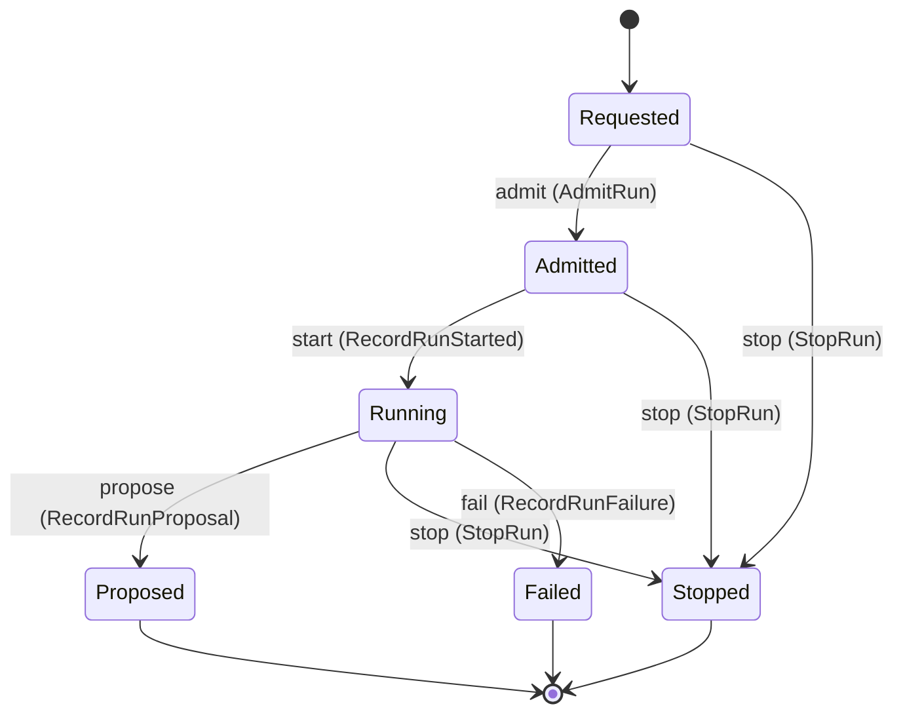

Each move is taken by a declared command outcome, and a move nothing takes is refused as `missing_causation` rather than left as a state change nobody can trigger:

- `admit` — taken by `agency.runs.AdmitRun` on its `admitted` outcome
- `start` — taken by `agency.runs.RecordRunStarted` on its `started` outcome
- `propose` — taken by `agency.runs.RecordRunProposal` on its `proposed` outcome
- `stop` — taken by `agency.runs.StopRun` on its `stopped` outcome
- `fail` — taken by `agency.runs.RecordRunFailure` on its `failed` outcome

An instance is brought into existence by `agency.runs.StartRun` on its `requested` outcome.

Illegal transitions are illegal by absence: no rule forbids them, there is simply no arrow, because a rule would be a second place for the same truth to live. A diagram cannot show an absence, so the pairs it does not connect are listed here, derived from the same transitions — anything named below is a move this specification does not permit.

- `Admitted` may not become `Failed`
- `Admitted` may not become `Proposed`
- `Admitted` may not become `Requested`
- `Failed` may not become `Admitted`
- `Failed` may not become `Proposed`
- `Failed` may not become `Requested`
- `Failed` may not become `Running`
- `Failed` may not become `Stopped`
- `Proposed` may not become `Admitted`
- `Proposed` may not become `Failed`
- `Proposed` may not become `Requested`
- `Proposed` may not become `Running`
- `Proposed` may not become `Stopped`
- `Requested` may not become `Failed`
- `Requested` may not become `Proposed`
- `Requested` may not become `Running`
- `Running` may not become `Admitted`
- `Running` may not become `Requested`
- `Stopped` may not become `Admitted`
- `Stopped` may not become `Failed`
- `Stopped` may not become `Proposed`
- `Stopped` may not become `Requested`
- `Stopped` may not become `Running`

Three views project it: [`RunDetail`](#rundetail), [`RunList`](#runlist) and [`UsageByAgent`](#usagebyagent).

### `RunApproval`

`agency.runs.RunApproval`.

An instance is identified by `approval_id`, a `agency.runs.ApprovalId`. The name is part of the model and not a convention: a view projects the identity under that name, so a projection inventing its own would disagree with the view.

It holds:

- `run_id` — `agency.runs.RunId`
- `subject` — `String`
- `capability` — `String`
- `requested_at` — `Timestamp`
- `answered_by` — `Optional<agency.auth.PrincipalId>`, which may be absent
- `answered_at` — `Optional<Timestamp>`, which may be absent

It references at most one [`Run`](#run), as `run`, carried by `RunApproval.run_id`. It references at most one [`agency.auth.Principal`](agency-auth.md#principal), as `answerer`, carried by `RunApproval.answered_by`.

No invariant is declared, so nothing here constrains an instance at rest.

Its state is a `agency.runs.RunApproval.State`, one of `Denied`, `Granted` and `Pending`. That enum is synthesised from the lifecycle rather than declared beside it, so the states a view's filter compares and the states drawn below cannot disagree.

An instance is created in `Pending`. `Denied` and `Granted` are terminal, so an instance may rest there forever. That is declared rather than inferred from having no way out: an entity that cannot leave a state is either finished or stuck, and only its author knows which.

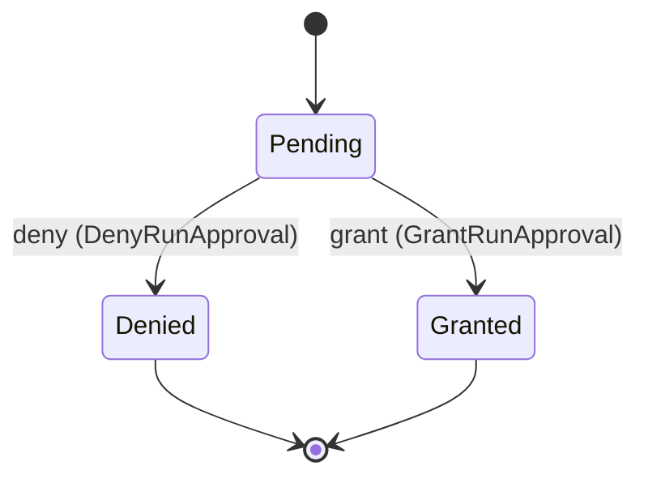

Each move is taken by a declared command outcome, and a move nothing takes is refused as `missing_causation` rather than left as a state change nobody can trigger:

- `grant` — taken by `agency.runs.GrantRunApproval` on its `granted` outcome
- `deny` — taken by `agency.runs.DenyRunApproval` on its `denied` outcome

An instance is brought into existence by `agency.runs.RequestRunApproval` on its `requested` outcome.

Illegal transitions are illegal by absence: no rule forbids them, there is simply no arrow, because a rule would be a second place for the same truth to live. A diagram cannot show an absence, so the pairs it does not connect are listed here, derived from the same transitions — anything named below is a move this specification does not permit.

- `Denied` may not become `Granted`
- `Denied` may not become `Pending`
- `Granted` may not become `Denied`
- `Granted` may not become `Pending`

One view projects it: [`ApprovalInbox`](#approvalinbox).

## Views

A view is what the outside world is promised it can observe. Each one says which instances it contains and how soon it reflects a command that has already returned, because "you can read this" without "how soon" is the promise every flaky suite is built on.

### `ApprovalInbox`

`agency.runs.ApprovalInbox`.

It reads [`RunApproval`](#runapproval).

It contains every instance of that entity: no filter narrows it, which is a decision somebody made and not a line somebody omitted.

It exposes:

- `approval_id` — `agency.runs.ApprovalId`
- `run_id` — `agency.runs.RunId`
- `subject` — `String`
- `capability` — `String`
- `requested_at` — `Timestamp`
- `answered_by` — `Optional<agency.auth.PrincipalId>`, which may be absent
- `answered_at` — `Optional<Timestamp>`, which may be absent
- `state` — `agency.runs.RunApproval.State`

It declares no order, so the rows come back in whatever order the implementation has, and two reads may disagree.

**Read-your-writes**: it is current the moment the command that changed it returns. A caller that has just created an invoice and cannot see it in here has been told a lie about what it did.

A generated scenario asserts it once, immediately after the command: a view promising this and not keeping the promise has to fail the suite rather than be retried until it passes.

### `RunDetail`

`agency.runs.RunDetail`.

It reads [`Run`](#run).

It contains the instances where `run_id == param.run_id` holds, and only those — so an instance a caller cannot find in here has been filtered out rather than lost.

It exposes:

- `run_id` — `agency.runs.RunId`
- `tenant_id` — `agency.auth.TenantId`
- `agent_id` — `agency.agents.AgentId`
- `work_item_ref` — `agency.work.WorkItemRef`
- `budget` — `agency.shared.RunBudget`
- `workspace` — `Optional<agency.runs.RunWorkspace>`, which may be absent
- `session_id` — `Optional<agency.runs.LoomSessionId>`, which may be absent
- `credential_source` — `Optional<agency.runs.CredentialSource>`, which may be absent
- `started_at` — `Timestamp`
- `ended_at` — `Optional<Timestamp>`, which may be absent
- `outcome` — `Optional<agency.runs.RunOutcome>`, which may be absent
- `usage` — `Optional<agency.runs.RunUsage>`, which may be absent
- `state` — `agency.runs.Run.State`

It declares no order, so the rows come back in whatever order the implementation has, and two reads may disagree.

**Read-your-writes**: it is current the moment the command that changed it returns. A caller that has just created an invoice and cannot see it in here has been told a lie about what it did.

A generated scenario asserts it once, immediately after the command: a view promising this and not keeping the promise has to fail the suite rather than be retried until it passes.

### `RunList`

`agency.runs.RunList`.

It reads [`Run`](#run).

It contains every instance of that entity: no filter narrows it, which is a decision somebody made and not a line somebody omitted.

It exposes:

- `run_id` — `agency.runs.RunId`
- `tenant_id` — `agency.auth.TenantId`
- `agent_id` — `agency.agents.AgentId`
- `work_item_ref` — `agency.work.WorkItemRef`
- `budget` — `agency.shared.RunBudget`
- `workspace` — `Optional<agency.runs.RunWorkspace>`, which may be absent
- `session_id` — `Optional<agency.runs.LoomSessionId>`, which may be absent
- `credential_source` — `Optional<agency.runs.CredentialSource>`, which may be absent
- `started_at` — `Timestamp`
- `ended_at` — `Optional<Timestamp>`, which may be absent
- `usage` — `Optional<agency.runs.RunUsage>`, which may be absent
- `state` — `agency.runs.Run.State`

It declares no order, so the rows come back in whatever order the implementation has, and two reads may disagree.

**Read-your-writes**: it is current the moment the command that changed it returns. A caller that has just created an invoice and cannot see it in here has been told a lie about what it did.

A generated scenario asserts it once, immediately after the command: a view promising this and not keeping the promise has to fail the suite rather than be retried until it passes.

### `UsageByAgent`

`agency.runs.UsageByAgent`.

It reads [`Run`](#run).

It contains every instance of that entity: no filter narrows it, which is a decision somebody made and not a line somebody omitted.

Grouped by `agent_id`; one row per group holding at least one instance.

It exposes:

- `agent_id` — `agency.agents.AgentId`
- `runs` — `Integer`, the count of instances in the group

It declares no order, so the rows come back in whatever order the implementation has, and two reads may disagree.

**Read-your-writes**: it is current the moment the command that changed it returns. A caller that has just created an invoice and cannot see it in here has been told a lie about what it did.

A generated scenario asserts it once, immediately after the command: a view promising this and not keeping the promise has to fail the suite rather than be retried until it passes.

## Commands

### `AdmitRun`

`agency.runs.AdmitRun`, shown to a person as "Record a run admitted by Loom".

It takes:

- `run_id` — `agency.runs.RunId`

It has three outcomes.

**`no-such-run`** — Taken when the identity the command names is one no record carries, before any other answer for it. No entity in this specification changes. It reports `agency.runs.NotFound`. It emits nothing. A test reaches it by sending an identity no record carries, arranging nothing.

**`admitted`** — The default branch, taken when no other outcome's condition matched. It moves a `agency.runs.Run` from `Requested` to `Admitted`, along the declared move `admit`. The instance is the one named by the input field `run_id`. It emits `agency.runs.RunAdmitted`. A test reaches it by constructing an input that satisfies no other outcome's condition.

**`wrong-state`** — Taken when the subject is resting in a state none of this command's moves start from — a `agency.runs.Run` in `Admitted`, `Failed`, `Proposed`, `Running` and `Stopped`, which is what is left of the lifecycle once this command's own moves are taken away. The document lists none of it. No entity in this specification changes. It reports `agency.runs.StateConflict`. It emits nothing. A test reaches it by driving an instance into one of those states and then issuing the command, because no input selects this branch.

### `DenyRunApproval`

`agency.runs.DenyRunApproval`, shown to a person as "Deny a run's approval".

It takes:

- `approval_id` — `agency.runs.ApprovalId`
- `answered_by` — `agency.auth.PrincipalId`

It has three outcomes.

**`no-such-approval`** — Taken when the identity the command names is one no record carries, before any other answer for it. No entity in this specification changes. It reports `agency.runs.NotFound`. It emits nothing. A test reaches it by sending an identity no record carries, arranging nothing.

**`denied`** — The default branch, taken when no other outcome's condition matched. It moves a `agency.runs.RunApproval` from `Pending` to `Denied`, along the declared move `deny`. The instance is the one named by the input field `approval_id`. It emits `agency.runs.RunApprovalDenied`. It sets `answered_by` from `input.answered_by` and `answered_at` from `implementation-generated`. A test reaches it by constructing an input that satisfies no other outcome's condition.

**`wrong-state`** — Taken when the subject is resting in a state none of this command's moves start from — a `agency.runs.RunApproval` in `Denied` and `Granted`, which is what is left of the lifecycle once this command's own moves are taken away. The document lists none of it. No entity in this specification changes. It reports `agency.runs.StateConflict`. It emits nothing. A test reaches it by driving an instance into one of those states and then issuing the command, because no input selects this branch.

### `GrantRunApproval`

`agency.runs.GrantRunApproval`, shown to a person as "Grant a run's approval".

It takes:

- `approval_id` — `agency.runs.ApprovalId`
- `answered_by` — `agency.auth.PrincipalId`

It has three outcomes.

**`no-such-approval`** — Taken when the identity the command names is one no record carries, before any other answer for it. No entity in this specification changes. It reports `agency.runs.NotFound`. It emits nothing. A test reaches it by sending an identity no record carries, arranging nothing.

**`granted`** — The default branch, taken when no other outcome's condition matched. It moves a `agency.runs.RunApproval` from `Pending` to `Granted`, along the declared move `grant`. The instance is the one named by the input field `approval_id`. It emits `agency.runs.RunApprovalGranted`. It sets `answered_by` from `input.answered_by` and `answered_at` from `implementation-generated`. A test reaches it by constructing an input that satisfies no other outcome's condition.

**`wrong-state`** — Taken when the subject is resting in a state none of this command's moves start from — a `agency.runs.RunApproval` in `Denied` and `Granted`, which is what is left of the lifecycle once this command's own moves are taken away. The document lists none of it. No entity in this specification changes. It reports `agency.runs.StateConflict`. It emits nothing. A test reaches it by driving an instance into one of those states and then issuing the command, because no input selects this branch.

### `RecordRunFailure`

`agency.runs.RecordRunFailure`, shown to a person as "Record a run's failure from Loom".

It takes:

- `run_id` — `agency.runs.RunId`
- `reason` — `String`

It has three outcomes.

**`no-such-run`** — Taken when the identity the command names is one no record carries, before any other answer for it. No entity in this specification changes. It reports `agency.runs.NotFound`. It emits nothing. A test reaches it by sending an identity no record carries, arranging nothing.

**`failed`** — The default branch, taken when no other outcome's condition matched. It moves a `agency.runs.Run` from `Running` to `Failed`, along the declared move `fail`. The instance is the one named by the input field `run_id`. It emits `agency.runs.RunFailed`. It sets `ended_at` from `implementation-generated`. A test reaches it by constructing an input that satisfies no other outcome's condition.

**`wrong-state`** — Taken when the subject is resting in a state none of this command's moves start from — a `agency.runs.Run` in `Admitted`, `Failed`, `Proposed`, `Requested` and `Stopped`, which is what is left of the lifecycle once this command's own moves are taken away. The document lists none of it. No entity in this specification changes. It reports `agency.runs.StateConflict`. It emits nothing. A test reaches it by driving an instance into one of those states and then issuing the command, because no input selects this branch.

### `RecordRunProposal`

`agency.runs.RecordRunProposal`, shown to a person as "Record a run's proposal from Loom".

It takes:

- `run_id` — `agency.runs.RunId`
- `usage` — `agency.runs.RunUsage`

It has three outcomes.

**`no-such-run`** — Taken when the identity the command names is one no record carries, before any other answer for it. No entity in this specification changes. It reports `agency.runs.NotFound`. It emits nothing. A test reaches it by sending an identity no record carries, arranging nothing.

**`proposed`** — The default branch, taken when no other outcome's condition matched. It moves a `agency.runs.Run` from `Running` to `Proposed`, along the declared move `propose`. The instance is the one named by the input field `run_id`. It emits `agency.runs.RunProposed`. It sets `ended_at` from `implementation-generated` and `usage` from `input.usage`. A test reaches it by constructing an input that satisfies no other outcome's condition.

**`wrong-state`** — Taken when the subject is resting in a state none of this command's moves start from — a `agency.runs.Run` in `Admitted`, `Failed`, `Proposed`, `Requested` and `Stopped`, which is what is left of the lifecycle once this command's own moves are taken away. The document lists none of it. No entity in this specification changes. It reports `agency.runs.StateConflict`. It emits nothing. A test reaches it by driving an instance into one of those states and then issuing the command, because no input selects this branch.

### `RecordRunStarted`

`agency.runs.RecordRunStarted`, shown to a person as "Record a run started in Loom".

It takes:

- `run_id` — `agency.runs.RunId`
- `session_id` — `agency.runs.LoomSessionId`
- `credential_source` — `agency.runs.CredentialSource`

It has three outcomes.

**`no-such-run`** — Taken when the identity the command names is one no record carries, before any other answer for it. No entity in this specification changes. It reports `agency.runs.NotFound`. It emits nothing. A test reaches it by sending an identity no record carries, arranging nothing.

**`started`** — The default branch, taken when no other outcome's condition matched. It moves a `agency.runs.Run` from `Admitted` to `Running`, along the declared move `start`. The instance is the one named by the input field `run_id`. It emits `agency.runs.RunStarted`. It sets `session_id` from `input.session_id` and `credential_source` from `input.credential_source`. A test reaches it by constructing an input that satisfies no other outcome's condition.

**`wrong-state`** — Taken when the subject is resting in a state none of this command's moves start from — a `agency.runs.Run` in `Failed`, `Proposed`, `Requested`, `Running` and `Stopped`, which is what is left of the lifecycle once this command's own moves are taken away. The document lists none of it. No entity in this specification changes. It reports `agency.runs.StateConflict`. It emits nothing. A test reaches it by driving an instance into one of those states and then issuing the command, because no input selects this branch.

### `RequestRunApproval`

`agency.runs.RequestRunApproval`, shown to a person as "Record a run's request for an approval".

It takes:

- `run_id` — `agency.runs.RunId`
- `subject` — `String`
- `capability` — `String`

It has one outcome.

**`requested`** — The default branch, taken when no other outcome's condition matched. It creates a `agency.runs.RunApproval`, which starts in `Pending`. The new instance's identity is published as `approval_id` on `agency.runs.RunApprovalRequested`. It emits `agency.runs.RunApprovalRequested`. It sets `run_id` from `input.run_id`, `subject` from `input.subject`, `capability` from `input.capability` and `requested_at` from `implementation-generated`. A test reaches it by constructing an input that satisfies no other outcome's condition.

### `SetRunBudget`

`agency.runs.SetRunBudget`, shown to a person as "Set a run's budget".

It takes:

- `run_id` — `agency.runs.RunId`
- `budget` — `agency.shared.RunBudget`

It has three outcomes.

**`no-such-run`** — Taken when the identity the command names is one no record carries, before any other answer for it. No entity in this specification changes. It reports `agency.runs.NotFound`. It emits nothing. A test reaches it by sending an identity no record carries, arranging nothing.

**`ended`** — Taken when the existing subject's stored fields satisfy `(state == Proposed or state == Stopped or state == Failed)`. No entity in this specification changes. It reports `agency.runs.RunEnded`. It emits nothing. A test establishes and independently observes the subject enum fact before selecting this branch.

**`set`** — The default branch, taken when no other outcome's condition matched. It changes a `agency.runs.Run` without moving it along its lifecycle. The instance is the one named by the input field `run_id`. It emits `agency.runs.RunBudgetSet`. It sets `budget` from `input.budget`. A test reaches it by constructing an input that satisfies no other outcome's condition.

### `StartRun`

`agency.runs.StartRun`, shown to a person as "Start a run".

It takes:

- `tenant_id` — `agency.auth.TenantId`
- `agent_id` — `agency.agents.AgentId`
- `work_item_ref` — `agency.work.WorkItemRef`
- `budget` — `agency.shared.RunBudget`
- `workspace` — `Optional<agency.runs.RunWorkspace>`, which may be absent

It has one outcome.

**`requested`** — The default branch, taken when no other outcome's condition matched. It creates a `agency.runs.Run`, which starts in `Requested`. The new instance's identity is published as `run_id` on `agency.runs.RunRequested`. It emits `agency.runs.RunRequested`. It sets `tenant_id` from `input.tenant_id`, `agent_id` from `input.agent_id`, `work_item_ref` from `input.work_item_ref`, `budget` from `input.budget`, `workspace` from `input.workspace` and `started_at` from `implementation-generated`. A test reaches it by constructing an input that satisfies no other outcome's condition.

### `StopRun`

`agency.runs.StopRun`, shown to a person as "Stop a run".

It takes:

- `run_id` — `agency.runs.RunId`
- `reason` — `String`

It has three outcomes.

**`no-such-run`** — Taken when the identity the command names is one no record carries, before any other answer for it. No entity in this specification changes. It reports `agency.runs.NotFound`. It emits nothing. A test reaches it by sending an identity no record carries, arranging nothing.

**`stopped`** — The default branch, taken when no other outcome's condition matched. It moves a `agency.runs.Run` from `Admitted`, `Requested` and `Running` to `Stopped`, along the declared move `stop`. The instance is the one named by the input field `run_id`. It emits `agency.runs.RunStopped`. It sets `ended_at` from `implementation-generated`. A test reaches it by constructing an input that satisfies no other outcome's condition.

**`wrong-state`** — Taken when the subject is resting in a state none of this command's moves start from — a `agency.runs.Run` in `Failed`, `Proposed` and `Stopped`, which is what is left of the lifecycle once this command's own moves are taken away. The document lists none of it. No entity in this specification changes. It reports `agency.runs.StateConflict`. It emits nothing. A test reaches it by driving an instance into one of those states and then issuing the command, because no input selects this branch.

## Events

### `RunAdmitted`

`agency.runs.RunAdmitted`.

It carries:

- `run_id` — `agency.runs.RunId`

Emitted by `agency.runs.AdmitRun` on its `admitted` outcome.

Nothing in this system reacts to it.

### `RunApprovalDenied`

`agency.runs.RunApprovalDenied`.

It carries:

- `approval_id` — `agency.runs.ApprovalId`
- `answered_by` — `agency.auth.PrincipalId`

Emitted by `agency.runs.DenyRunApproval` on its `denied` outcome.

Nothing in this system reacts to it.

### `RunApprovalGranted`

`agency.runs.RunApprovalGranted`.

It carries:

- `approval_id` — `agency.runs.ApprovalId`
- `answered_by` — `agency.auth.PrincipalId`

Emitted by `agency.runs.GrantRunApproval` on its `granted` outcome.

Nothing in this system reacts to it.

### `RunApprovalRequested`

`agency.runs.RunApprovalRequested`.

It carries:

- `approval_id` — `agency.runs.ApprovalId`
- `run_id` — `agency.runs.RunId`
- `subject` — `String`
- `capability` — `String`

Emitted by `agency.runs.RequestRunApproval` on its `requested` outcome.

Nothing in this system reacts to it.

### `RunBudgetSet`

`agency.runs.RunBudgetSet`.

It carries:

- `run_id` — `agency.runs.RunId`
- `budget` — `agency.shared.RunBudget`

Emitted by `agency.runs.SetRunBudget` on its `set` outcome.

Nothing in this system reacts to it.

### `RunFailed`

`agency.runs.RunFailed`.

It carries:

- `run_id` — `agency.runs.RunId`
- `reason` — `String`

Emitted by `agency.runs.RecordRunFailure` on its `failed` outcome.

Nothing in this system reacts to it.

### `RunProposed`

`agency.runs.RunProposed`.

It carries:

- `run_id` — `agency.runs.RunId`
- `usage` — `agency.runs.RunUsage`

Emitted by `agency.runs.RecordRunProposal` on its `proposed` outcome.

Nothing in this system reacts to it.

### `RunRequested`

`agency.runs.RunRequested`.

It carries:

- `run_id` — `agency.runs.RunId`
- `agent_id` — `agency.agents.AgentId`
- `work_item_ref` — `agency.work.WorkItemRef`

Emitted by `agency.runs.StartRun` on its `requested` outcome.

Nothing in this system reacts to it.

### `RunStarted`

`agency.runs.RunStarted`.

It carries:

- `run_id` — `agency.runs.RunId`
- `session_id` — `agency.runs.LoomSessionId`
- `credential_source` — `agency.runs.CredentialSource`

Emitted by `agency.runs.RecordRunStarted` on its `started` outcome.

Nothing in this system reacts to it.

### `RunStopped`

`agency.runs.RunStopped`.

It carries:

- `run_id` — `agency.runs.RunId`
- `reason` — `String`

Emitted by `agency.runs.StopRun` on its `stopped` outcome.

Nothing in this system reacts to it.

## Errors

### `NotFound`

The addressed record does not exist, and nothing changed.

It carries nothing beyond its name, so a caller can tell what went wrong and not which value caused it.

Reported by `agency.runs.AdmitRun` on its `no-such-run` outcome.

Reported by `agency.runs.DenyRunApproval` on its `no-such-approval` outcome.

Reported by `agency.runs.GrantRunApproval` on its `no-such-approval` outcome.

Reported by `agency.runs.RecordRunFailure` on its `no-such-run` outcome.

Reported by `agency.runs.RecordRunProposal` on its `no-such-run` outcome.

Reported by `agency.runs.RecordRunStarted` on its `no-such-run` outcome.

Reported by `agency.runs.SetRunBudget` on its `no-such-run` outcome.

Reported by `agency.runs.StopRun` on its `no-such-run` outcome.

### `RunEnded`

The run has ended, so its budget is not changed.

It carries nothing beyond its name, so a caller can tell what went wrong and not which value caused it.

Reported by `agency.runs.SetRunBudget` on its `ended` outcome.

### `StateConflict`

The addressed record is not in a state this command acts from, and nothing changed.

It carries nothing beyond its name, so a caller can tell what went wrong and not which value caused it.

Reported by `agency.runs.AdmitRun` on its `wrong-state` outcome.

Reported by `agency.runs.DenyRunApproval` on its `wrong-state` outcome.

Reported by `agency.runs.GrantRunApproval` on its `wrong-state` outcome.

Reported by `agency.runs.RecordRunFailure` on its `wrong-state` outcome.

Reported by `agency.runs.RecordRunProposal` on its `wrong-state` outcome.

Reported by `agency.runs.RecordRunStarted` on its `wrong-state` outcome.

Reported by `agency.runs.StopRun` on its `wrong-state` outcome.

## Actors

An actor is who may ask this context for something. Every grant below points at a command this specification declares — a grant is a resolved reference, so "may invoke" something nobody wrote is not a permission this model can express, and an authorisation that authorises nothing cannot ship quietly.

### `LoomReadback`

`agency.runs.LoomReadback`.

It may invoke [`AdmitRun`](#admitrun), [`RecordRunFailure`](#recordrunfailure), [`RecordRunProposal`](#recordrunproposal), [`RecordRunStarted`](#recordrunstarted) and [`RequestRunApproval`](#requestrunapproval).

---

Generated from agency v1 · model digest `71132e90bde806415603d08bb97a71629b2c2f6cda30e1f22e76f407abd9a3eb` · contract digest `slice-sha256/2:87f021e51fc6659d3c22216a051d9034a5ff31b13d6adda6beb86011e2a3640b`. Do not edit this file; change the specification and regenerate it with `ess generate`.

<!--
generated from agency v1
model digest 71132e90bde806415603d08bb97a71629b2c2f6cda30e1f22e76f407abd9a3eb
contract digest slice-sha256/2:70586102dc72a80f0006d136d301761e99bc9aa5e2291c1e93cb1f4b4444d9b8
do not edit: regenerate with `ess generate`
-->

# Service

The authenticated sessions of the Agency service: an operator's browser session, an application's token and a run's bearer, each held by the digest of its secret.

`agency.service` is one of agency's bounded contexts. [Back to the index](../index.md).

## Types

### `SessionId`

`agency.service.SessionId` wraps `Uuid` and is not interchangeable with one: the whole value of naming it separately is the crossings the model then refuses.

### `SessionKind`

`agency.service.SessionKind` is one of `OperatorCookie`, `ApplicationToken` and `RunBearer`.

## Entities

An entity is what this context is about: something with an identity that outlives any one request, a shape, and a lifecycle. The lifecycle is exhaustive — a move that is not drawn below is a move this specification does not permit, and that is the only way it says so. Every move is labelled with the command that takes it, because a move nothing can trigger is refused rather than drawn.

### `Session`

`agency.service.Session`.

An instance is identified by `session_id`, a `agency.service.SessionId`. The name is part of the model and not a convention: a view projects the identity under that name, so a projection inventing its own would disagree with the view.

It holds:

- `principal_id` — `agency.auth.PrincipalId`
- `kind` — `agency.service.SessionKind`
- `run_id` — `Optional<agency.runs.RunId>`, which may be absent
- `token_digest` — `agency.shared.Digest`
- `csrf_digest` — `Optional<agency.shared.Digest>`, which may be absent
- `opened_at` — `Timestamp`
- `expires_at` — `Optional<Timestamp>`, which may be absent

It references at most one [`agency.auth.Principal`](agency-auth.md#principal), as `principal`, carried by `Session.principal_id`. It references at most one [`agency.runs.Run`](agency-runs.md#run), as `run`, carried by `Session.run_id`.

No invariant is declared, so nothing here constrains an instance at rest.

Its state is a `agency.service.Session.State`, one of `Closed` and `Open`. That enum is synthesised from the lifecycle rather than declared beside it, so the states a view's filter compares and the states drawn below cannot disagree.

An instance is created in `Open`. `Closed` is terminal, so an instance may rest there forever. That is declared rather than inferred from having no way out: an entity that cannot leave a state is either finished or stuck, and only its author knows which.

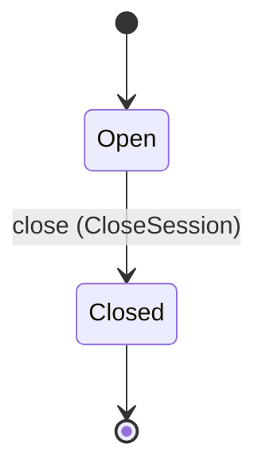

Each move is taken by a declared command outcome, and a move nothing takes is refused as `missing_causation` rather than left as a state change nobody can trigger:

- `close` — taken by `agency.service.CloseSession` on its `closed` outcome

An instance is brought into existence by `agency.service.OpenSession` on its `opened` outcome.

Illegal transitions are illegal by absence: no rule forbids them, there is simply no arrow, because a rule would be a second place for the same truth to live. A diagram cannot show an absence, so the pairs it does not connect are listed here, derived from the same transitions — anything named below is a move this specification does not permit.

- `Closed` may not become `Open`

One view projects it: [`SessionList`](#sessionlist).

## Views

A view is what the outside world is promised it can observe. Each one says which instances it contains and how soon it reflects a command that has already returned, because "you can read this" without "how soon" is the promise every flaky suite is built on.

### `SessionList`

`agency.service.SessionList`.

It reads [`Session`](#session).

It contains every instance of that entity: no filter narrows it, which is a decision somebody made and not a line somebody omitted.

It exposes:

- `session_id` — `agency.service.SessionId`
- `principal_id` — `agency.auth.PrincipalId`
- `kind` — `agency.service.SessionKind`
- `run_id` — `Optional<agency.runs.RunId>`, which may be absent
- `opened_at` — `Timestamp`
- `expires_at` — `Optional<Timestamp>`, which may be absent
- `state` — `agency.service.Session.State`

It declares no order, so the rows come back in whatever order the implementation has, and two reads may disagree.

**Read-your-writes**: it is current the moment the command that changed it returns. A caller that has just created an invoice and cannot see it in here has been told a lie about what it did.

A generated scenario asserts it once, immediately after the command: a view promising this and not keeping the promise has to fail the suite rather than be retried until it passes.

## Commands

### `CloseSession`

`agency.service.CloseSession`, shown to a person as "Close a session".

It takes:

- `session_id` — `agency.service.SessionId`

It has three outcomes.

**`no-such-session`** — Taken when the identity the command names is one no record carries, before any other answer for it. No entity in this specification changes. It reports `agency.service.NotFound`. It emits nothing. A test reaches it by sending an identity no record carries, arranging nothing.

**`closed`** — The default branch, taken when no other outcome's condition matched. It moves a `agency.service.Session` from `Open` to `Closed`, along the declared move `close`. The instance is the one named by the input field `session_id`. It emits `agency.service.SessionClosed`. A test reaches it by constructing an input that satisfies no other outcome's condition.

**`wrong-state`** — Taken when the subject is resting in a state none of this command's moves start from — a `agency.service.Session` in `Closed`, which is what is left of the lifecycle once this command's own moves are taken away. The document lists none of it. No entity in this specification changes. It reports `agency.service.StateConflict`. It emits nothing. A test reaches it by driving an instance into one of those states and then issuing the command, because no input selects this branch.

### `OpenSession`

`agency.service.OpenSession`, shown to a person as "Open a session".

It takes:

- `principal_id` — `agency.auth.PrincipalId`
- `kind` — `agency.service.SessionKind`
- `run_id` — `Optional<agency.runs.RunId>`, which may be absent
- `token_digest` — `agency.shared.Digest`
- `csrf_digest` — `Optional<agency.shared.Digest>`, which may be absent
- `expires_at` — `Optional<Timestamp>`, which may be absent

It has one outcome.

**`opened`** — The default branch, taken when no other outcome's condition matched. It creates a `agency.service.Session`, which starts in `Open`. The new instance's identity is published as `session_id` on `agency.service.SessionOpened`. It emits `agency.service.SessionOpened`. It sets `principal_id` from `input.principal_id`, `kind` from `input.kind`, `run_id` from `input.run_id`, `token_digest` from `input.token_digest`, `csrf_digest` from `input.csrf_digest`, `opened_at` from `implementation-generated` and `expires_at` from `input.expires_at`. A test reaches it by constructing an input that satisfies no other outcome's condition.

## Events

### `SessionClosed`

`agency.service.SessionClosed`.

It carries:

- `session_id` — `agency.service.SessionId`

Emitted by `agency.service.CloseSession` on its `closed` outcome.

Nothing in this system reacts to it.

### `SessionOpened`

`agency.service.SessionOpened`.

It carries:

- `session_id` — `agency.service.SessionId`
- `principal_id` — `agency.auth.PrincipalId`
- `kind` — `agency.service.SessionKind`

Emitted by `agency.service.OpenSession` on its `opened` outcome.

Nothing in this system reacts to it.

## Errors

### `NotFound`

The addressed record does not exist, and nothing changed.

It carries nothing beyond its name, so a caller can tell what went wrong and not which value caused it.

Reported by `agency.service.CloseSession` on its `no-such-session` outcome.

### `StateConflict`

The addressed record is not in a state this command acts from, and nothing changed.

It carries nothing beyond its name, so a caller can tell what went wrong and not which value caused it.

Reported by `agency.service.CloseSession` on its `wrong-state` outcome.

## Actors

An actor is who may ask this context for something. Every grant below points at a command this specification declares — a grant is a resolved reference, so "may invoke" something nobody wrote is not a permission this model can express, and an authorisation that authorises nothing cannot ship quietly.

### `Gatekeeper`

`agency.service.Gatekeeper`.

It may invoke [`CloseSession`](#closesession) and [`OpenSession`](#opensession).

---

Generated from agency v1 · model digest `71132e90bde806415603d08bb97a71629b2c2f6cda30e1f22e76f407abd9a3eb` · contract digest `slice-sha256/2:70586102dc72a80f0006d136d301761e99bc9aa5e2291c1e93cb1f4b4444d9b8`. Do not edit this file; change the specification and regenerate it with `ess generate`.

<!--
generated from agency v1
model digest 71132e90bde806415603d08bb97a71629b2c2f6cda30e1f22e76f407abd9a3eb
contract digest slice-sha256/2:c9652dbc5837f2cadeaf219925de817e3912aae234fa51388b67d2ea5da11fe5
do not edit: regenerate with `ess generate`
-->

# Shared

Value types shared by the Agency sub-domains.

`agency.shared` is one of agency's bounded contexts. [Back to the index](../index.md).

## Types

### `Digest`

`agency.shared.Digest` wraps `String` and is not interchangeable with one: the whole value of naming it separately is the crossings the model then refuses.

### `RunBudget`

`agency.shared.RunBudget` is a record of two fields:

- `max_tokens` — `Optional<Integer>`, which may be absent
- `deadline` — `Optional<Timestamp>`, which may be absent

### `Verb`

`agency.shared.Verb` wraps `String` and is not interchangeable with one: the whole value of naming it separately is the crossings the model then refuses.

---

Generated from agency v1 · model digest `71132e90bde806415603d08bb97a71629b2c2f6cda30e1f22e76f407abd9a3eb` · contract digest `slice-sha256/2:c9652dbc5837f2cadeaf219925de817e3912aae234fa51388b67d2ea5da11fe5`. Do not edit this file; change the specification and regenerate it with `ess generate`.

<!--
generated from agency v1
model digest 71132e90bde806415603d08bb97a71629b2c2f6cda30e1f22e76f407abd9a3eb
contract digest slice-sha256/2:c9652dbc5837f2cadeaf219925de817e3912aae234fa51388b67d2ea5da11fe5
do not edit: regenerate with `ess generate`
-->

# Teams

Teams of agents and the messages they exchange, the swarm records Agency holds a stop lever for, and workforces that say who is on duty for which queue.

`agency.teams` is one of agency's bounded contexts. [Back to the index](../index.md).

## Types

### `Capacity`

`agency.teams.Capacity` is a record of two fields:

- `max_concurrent_runs` — `Integer`
- `max_tokens_per_hour` — `Optional<Integer>`, which may be absent

### `SwarmId`

`agency.teams.SwarmId` wraps `Uuid` and is not interchangeable with one: the whole value of naming it separately is the crossings the model then refuses.

### `TeamId`

`agency.teams.TeamId` wraps `Uuid` and is not interchangeable with one: the whole value of naming it separately is the crossings the model then refuses.

### `WorkforceId`

`agency.teams.WorkforceId` wraps `Uuid` and is not interchangeable with one: the whole value of naming it separately is the crossings the model then refuses.

## Entities

An entity is what this context is about: something with an identity that outlives any one request, a shape, and a lifecycle. The lifecycle is exhaustive — a move that is not drawn below is a move this specification does not permit, and that is the only way it says so. Every move is labelled with the command that takes it, because a move nothing can trigger is refused rather than drawn.

### `Swarm`

`agency.teams.Swarm`.

An instance is identified by `swarm_id`, a `agency.teams.SwarmId`. The name is part of the model and not a convention: a view projects the identity under that name, so a projection inventing its own would disagree with the view.

It holds:

- `tenant_id` — `agency.auth.TenantId`
- `goal_ref` — `String`
- `coordinator_agent_id` — `agency.agents.AgentId`
- `frame_digest` — `agency.shared.Digest`
- `max_workers` — `Integer`
- `team_id` — `agency.teams.TeamId`
- `work_input_id` — `agency.work.InputId`

It references at most one [`agency.agents.Agent`](agency-agents.md#agent), as `coordinator`, carried by `Swarm.coordinator_agent_id`. It references at most one [`Team`](#team), as `team`, carried by `Swarm.team_id`. It references at most one [`agency.work.WorkInput`](agency-work.md#workinput), as `work_input`, carried by `Swarm.work_input_id`. Its `tenant_id` is what [`agency.auth.Tenant`](agency-auth.md#tenant) owns it by, as `swarms`.

No invariant is declared, so nothing here constrains an instance at rest.

Its state is a `agency.teams.Swarm.State`, one of `Declared` and `Stopped`. That enum is synthesised from the lifecycle rather than declared beside it, so the states a view's filter compares and the states drawn below cannot disagree.

An instance is created in `Declared`. `Stopped` is terminal, so an instance may rest there forever. That is declared rather than inferred from having no way out: an entity that cannot leave a state is either finished or stuck, and only its author knows which.

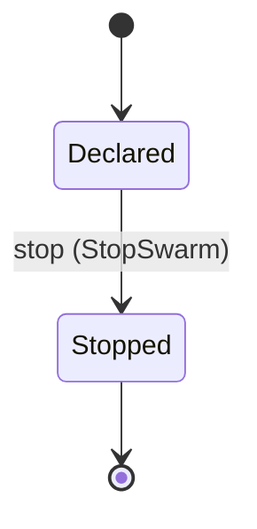

Each move is taken by a declared command outcome, and a move nothing takes is refused as `missing_causation` rather than left as a state change nobody can trigger:

- `stop` — taken by `agency.teams.StopSwarm` on its `stopped` outcome

An instance is brought into existence by `agency.teams.DeclareSwarm` on its `declared` outcome.

Illegal transitions are illegal by absence: no rule forbids them, there is simply no arrow, because a rule would be a second place for the same truth to live. A diagram cannot show an absence, so the pairs it does not connect are listed here, derived from the same transitions — anything named below is a move this specification does not permit.

- `Stopped` may not become `Declared`

One view projects it: [`SwarmList`](#swarmlist).

### `Team`

`agency.teams.Team`.

An instance is identified by `team_id`, a `agency.teams.TeamId`. The name is part of the model and not a convention: a view projects the identity under that name, so a projection inventing its own would disagree with the view.

It holds:

- `tenant_id` — `agency.auth.TenantId`
- `name` — `String`
- `lead_agent_id` — `agency.agents.AgentId`
- `members` — `List<agency.agents.AgentId>`
- `broker_ref` — `String`

It references at most one [`agency.agents.Agent`](agency-agents.md#agent), as `lead`, carried by `Team.lead_agent_id`. It references any number of [`agency.agents.Agent`](agency-agents.md#agent), as `member_agents`, carried by `Team.members`. Its `tenant_id` is what [`agency.auth.Tenant`](agency-auth.md#tenant) owns it by, as `teams`.

No invariant is declared, so nothing here constrains an instance at rest.

Its state is a `agency.teams.Team.State`, one of `Disbanded` and `Formed`. That enum is synthesised from the lifecycle rather than declared beside it, so the states a view's filter compares and the states drawn below cannot disagree.

An instance is created in `Formed`. `Disbanded` is terminal, so an instance may rest there forever. That is declared rather than inferred from having no way out: an entity that cannot leave a state is either finished or stuck, and only its author knows which.

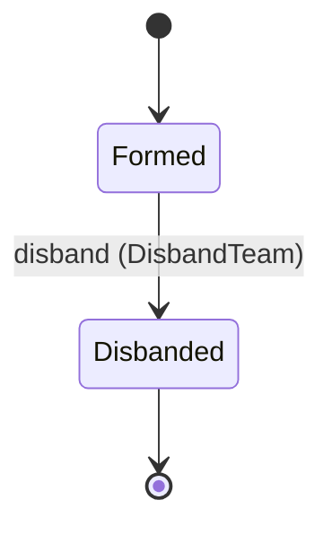

Each move is taken by a declared command outcome, and a move nothing takes is refused as `missing_causation` rather than left as a state change nobody can trigger:

- `disband` — taken by `agency.teams.DisbandTeam` on its `disbanded` outcome

An instance is brought into existence by `agency.teams.FormTeam` on its `formed` outcome.

Illegal transitions are illegal by absence: no rule forbids them, there is simply no arrow, because a rule would be a second place for the same truth to live. A diagram cannot show an absence, so the pairs it does not connect are listed here, derived from the same transitions — anything named below is a move this specification does not permit.

- `Disbanded` may not become `Formed`

Two views project it: [`TeamDetail`](#teamdetail) and [`TeamList`](#teamlist).

### `Workforce`

`agency.teams.Workforce`.

An instance is identified by `workforce_id`, a `agency.teams.WorkforceId`. The name is part of the model and not a convention: a view projects the identity under that name, so a projection inventing its own would disagree with the view.

It holds:

- `tenant_id` — `agency.auth.TenantId`
- `name` — `String`
- `teams` — `List<agency.teams.TeamId>`
- `solo_agents` — `List<agency.agents.AgentId>`
- `capacity` — `agency.teams.Capacity`

It references any number of [`Team`](#team), as `staffed_teams`, carried by `Workforce.teams`. It references any number of [`agency.agents.Agent`](agency-agents.md#agent), as `agents`, carried by `Workforce.solo_agents`. Its `tenant_id` is what [`agency.auth.Tenant`](agency-auth.md#tenant) owns it by, as `workforces`.

No invariant is declared, so nothing here constrains an instance at rest.

Its state is a `agency.teams.Workforce.State`, one of `Defined`, `Retired` and `Staffed`. That enum is synthesised from the lifecycle rather than declared beside it, so the states a view's filter compares and the states drawn below cannot disagree.

An instance is created in `Defined`. `Retired` is terminal, so an instance may rest there forever. That is declared rather than inferred from having no way out: an entity that cannot leave a state is either finished or stuck, and only its author knows which.

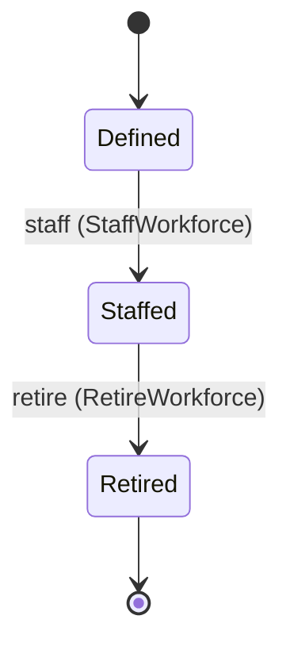

Each move is taken by a declared command outcome, and a move nothing takes is refused as `missing_causation` rather than left as a state change nobody can trigger:

- `staff` — taken by `agency.teams.StaffWorkforce` on its `staffed` outcome
- `retire` — taken by `agency.teams.RetireWorkforce` on its `retired` outcome

An instance is brought into existence by `agency.teams.DefineWorkforce` on its `defined` outcome.

Illegal transitions are illegal by absence: no rule forbids them, there is simply no arrow, because a rule would be a second place for the same truth to live. A diagram cannot show an absence, so the pairs it does not connect are listed here, derived from the same transitions — anything named below is a move this specification does not permit.

- `Defined` may not become `Retired`
- `Retired` may not become `Defined`
- `Retired` may not become `Staffed`
- `Staffed` may not become `Defined`

One view projects it: [`WorkforceBoard`](#workforceboard).

## Views

A view is what the outside world is promised it can observe. Each one says which instances it contains and how soon it reflects a command that has already returned, because "you can read this" without "how soon" is the promise every flaky suite is built on.

### `SwarmList`

`agency.teams.SwarmList`.

It reads [`Swarm`](#swarm).

It contains every instance of that entity: no filter narrows it, which is a decision somebody made and not a line somebody omitted.

It exposes:

- `swarm_id` — `agency.teams.SwarmId`
- `tenant_id` — `agency.auth.TenantId`
- `goal_ref` — `String`
- `coordinator_agent_id` — `agency.agents.AgentId`
- `frame_digest` — `agency.shared.Digest`
- `max_workers` — `Integer`
- `team_id` — `agency.teams.TeamId`
- `work_input_id` — `agency.work.InputId`
- `state` — `agency.teams.Swarm.State`

It declares no order, so the rows come back in whatever order the implementation has, and two reads may disagree.

**Read-your-writes**: it is current the moment the command that changed it returns. A caller that has just created an invoice and cannot see it in here has been told a lie about what it did.

A generated scenario asserts it once, immediately after the command: a view promising this and not keeping the promise has to fail the suite rather than be retried until it passes.

### `TeamDetail`

`agency.teams.TeamDetail`.

It reads [`Team`](#team).

It contains the instances where `team_id == param.team_id` holds, and only those — so an instance a caller cannot find in here has been filtered out rather than lost.

It exposes:

- `team_id` — `agency.teams.TeamId`
- `tenant_id` — `agency.auth.TenantId`
- `name` — `String`
- `lead_agent_id` — `agency.agents.AgentId`
- `members` — `List<agency.agents.AgentId>`
- `broker_ref` — `String`
- `state` — `agency.teams.Team.State`

It declares no order, so the rows come back in whatever order the implementation has, and two reads may disagree.

**Read-your-writes**: it is current the moment the command that changed it returns. A caller that has just created an invoice and cannot see it in here has been told a lie about what it did.

A generated scenario asserts it once, immediately after the command: a view promising this and not keeping the promise has to fail the suite rather than be retried until it passes.

### `TeamList`

`agency.teams.TeamList`.

It reads [`Team`](#team).

It contains every instance of that entity: no filter narrows it, which is a decision somebody made and not a line somebody omitted.

It exposes:

- `team_id` — `agency.teams.TeamId`
- `tenant_id` — `agency.auth.TenantId`
- `name` — `String`
- `lead_agent_id` — `agency.agents.AgentId`
- `members` — `List<agency.agents.AgentId>`
- `state` — `agency.teams.Team.State`

It declares no order, so the rows come back in whatever order the implementation has, and two reads may disagree.

**Read-your-writes**: it is current the moment the command that changed it returns. A caller that has just created an invoice and cannot see it in here has been told a lie about what it did.

A generated scenario asserts it once, immediately after the command: a view promising this and not keeping the promise has to fail the suite rather than be retried until it passes.

### `WorkforceBoard`

`agency.teams.WorkforceBoard`.

It reads [`Workforce`](#workforce).

It contains every instance of that entity: no filter narrows it, which is a decision somebody made and not a line somebody omitted.

It exposes:

- `workforce_id` — `agency.teams.WorkforceId`
- `tenant_id` — `agency.auth.TenantId`
- `name` — `String`
- `teams` — `List<agency.teams.TeamId>`
- `solo_agents` — `List<agency.agents.AgentId>`
- `capacity` — `agency.teams.Capacity`
- `state` — `agency.teams.Workforce.State`

It declares no order, so the rows come back in whatever order the implementation has, and two reads may disagree.

**Read-your-writes**: it is current the moment the command that changed it returns. A caller that has just created an invoice and cannot see it in here has been told a lie about what it did.

A generated scenario asserts it once, immediately after the command: a view promising this and not keeping the promise has to fail the suite rather than be retried until it passes.

## Commands

### `AddMember`

`agency.teams.AddMember`, shown to a person as "Add a team member".

It takes:

- `team_id` — `agency.teams.TeamId`
- `agent_id` — `agency.agents.AgentId`

It has two outcomes.

**`no-such-team`** — Taken when the identity the command names is one no record carries, before any other answer for it. No entity in this specification changes. It reports `agency.teams.NotFound`. It emits nothing. A test reaches it by sending an identity no record carries, arranging nothing.

**`added`** — The default branch, taken when no other outcome's condition matched. It changes a `agency.teams.Team` without moving it along its lifecycle. The instance is the one named by the input field `team_id`. It emits `agency.teams.MemberAdded`. A test reaches it by constructing an input that satisfies no other outcome's condition.

### `AttachQueue`

`agency.teams.AttachQueue`, shown to a person as "Attach a queue to a workforce".

It takes:

- `workforce_id` — `agency.teams.WorkforceId`
- `input_id` — `agency.work.InputId`

It has two outcomes.

**`no-such-input`** — Taken when the identity the command names is one no record carries, before any other answer for it. No entity in this specification changes. It reports `agency.teams.NotFound`. It emits nothing. A test reaches it by sending an identity no record carries, arranging nothing.

**`attached`** — The default branch, taken when no other outcome's condition matched. It changes a `agency.work.WorkInput` without moving it along its lifecycle. The instance is the one named by the input field `input_id`. It emits `agency.teams.QueueAttached`. It sets `workforce_id` from `input.workforce_id`. A test reaches it by constructing an input that satisfies no other outcome's condition.

### `DeclareSwarm`

`agency.teams.DeclareSwarm`, shown to a person as "Declare a swarm".

It takes:

- `tenant_id` — `agency.auth.TenantId`
- `goal_ref` — `String`
- `coordinator_agent_id` — `agency.agents.AgentId`
- `frame_digest` — `agency.shared.Digest`
- `max_workers` — `Integer`
- `team_id` — `agency.teams.TeamId`
- `work_input_id` — `agency.work.InputId`

It has one outcome.

**`declared`** — The default branch, taken when no other outcome's condition matched. It creates a `agency.teams.Swarm`, which starts in `Declared`. The new instance's identity is published as `swarm_id` on `agency.teams.SwarmDeclared`. It emits `agency.teams.SwarmDeclared`. It sets `tenant_id` from `input.tenant_id`, `goal_ref` from `input.goal_ref`, `coordinator_agent_id` from `input.coordinator_agent_id`, `frame_digest` from `input.frame_digest`, `max_workers` from `input.max_workers`, `team_id` from `input.team_id` and `work_input_id` from `input.work_input_id`. A test reaches it by constructing an input that satisfies no other outcome's condition.

### `DefineWorkforce`

`agency.teams.DefineWorkforce`, shown to a person as "Define a workforce".

It takes:

- `tenant_id` — `agency.auth.TenantId`
- `name` — `String`
- `capacity` — `agency.teams.Capacity`

It has one outcome.

**`defined`** — The default branch, taken when no other outcome's condition matched. It creates a `agency.teams.Workforce`, which starts in `Defined`. The new instance's identity is published as `workforce_id` on `agency.teams.WorkforceDefined`. It emits `agency.teams.WorkforceDefined`. It sets `tenant_id` from `input.tenant_id`, `name` from `input.name`, `teams` set to the empty list `[]`, `solo_agents` set to the empty list `[]` and `capacity` from `input.capacity`. A test reaches it by constructing an input that satisfies no other outcome's condition.

### `DisbandTeam`

`agency.teams.DisbandTeam`, shown to a person as "Disband a team".

It takes:

- `team_id` — `agency.teams.TeamId`

It has three outcomes.

**`no-such-team`** — Taken when the identity the command names is one no record carries, before any other answer for it. No entity in this specification changes. It reports `agency.teams.NotFound`. It emits nothing. A test reaches it by sending an identity no record carries, arranging nothing.

**`disbanded`** — The default branch, taken when no other outcome's condition matched. It moves a `agency.teams.Team` from `Formed` to `Disbanded`, along the declared move `disband`. The instance is the one named by the input field `team_id`. It emits `agency.teams.TeamDisbanded`. A test reaches it by constructing an input that satisfies no other outcome's condition.

**`wrong-state`** — Taken when the subject is resting in a state none of this command's moves start from — a `agency.teams.Team` in `Disbanded`, which is what is left of the lifecycle once this command's own moves are taken away. The document lists none of it. No entity in this specification changes. It reports `agency.teams.StateConflict`. It emits nothing. A test reaches it by driving an instance into one of those states and then issuing the command, because no input selects this branch.

### `FormTeam`

`agency.teams.FormTeam`, shown to a person as "Form a team".

It takes:

- `tenant_id` — `agency.auth.TenantId`
- `name` — `String`
- `lead_agent_id` — `agency.agents.AgentId`
- `members` — `List<agency.agents.AgentId>`
- `broker_ref` — `String`

It has one outcome.

**`formed`** — The default branch, taken when no other outcome's condition matched. It creates a `agency.teams.Team`, which starts in `Formed`. The new instance's identity is published as `team_id` on `agency.teams.TeamFormed`. It emits `agency.teams.TeamFormed`. It sets `tenant_id` from `input.tenant_id`, `name` from `input.name`, `lead_agent_id` from `input.lead_agent_id`, `members` from `input.members` and `broker_ref` from `input.broker_ref`. A test reaches it by constructing an input that satisfies no other outcome's condition.

### `RemoveMember`

`agency.teams.RemoveMember`, shown to a person as "Remove a team member".

It takes:

- `team_id` — `agency.teams.TeamId`
- `agent_id` — `agency.agents.AgentId`

It has two outcomes.

**`no-such-team`** — Taken when the identity the command names is one no record carries, before any other answer for it. No entity in this specification changes. It reports `agency.teams.NotFound`. It emits nothing. A test reaches it by sending an identity no record carries, arranging nothing.

**`removed`** — The default branch, taken when no other outcome's condition matched. It changes a `agency.teams.Team` without moving it along its lifecycle. The instance is the one named by the input field `team_id`. It emits `agency.teams.MemberRemoved`. A test reaches it by constructing an input that satisfies no other outcome's condition.

### `Report`

`agency.teams.Report`, shown to a person as "Report up one level".

It takes:

- `team_id` — `agency.teams.TeamId`
- `from_agent_id` — `agency.agents.AgentId`
- `status` — `String`
- `line` — `String`
- `to` — `Optional<String>`, which may be absent

It has three outcomes.

**`no-such-team`** — Taken when the identity the command names is one no record carries, before any other answer for it. No entity in this specification changes. It reports `agency.teams.NotFound`. It emits nothing. A test reaches it by sending an identity no record carries, arranging nothing.

**`not-one-level-up`** — Decided outside the input: the report names a recipient other than the one above the sender, or nothing is above it. No predicate over the input reaches this branch, and saying `when: false` instead would have claimed it is unreachable, which is a different and false statement. No entity in this specification changes. It reports `agency.teams.NotOneLevelUp`. It emits nothing. A test reaches it by injecting the declared fault, because no input can.

**`reported`** — The default branch, taken when no other outcome's condition matched. It changes a `agency.teams.Team` without moving it along its lifecycle. The instance is the one named by the input field `team_id`. It emits `agency.teams.ReportSent`. A test reaches it by constructing an input that satisfies no other outcome's condition.

### `RetireWorkforce`

`agency.teams.RetireWorkforce`, shown to a person as "Retire a workforce".

It takes:

- `workforce_id` — `agency.teams.WorkforceId`

It has three outcomes.

**`no-such-workforce`** — Taken when the identity the command names is one no record carries, before any other answer for it. No entity in this specification changes. It reports `agency.teams.NotFound`. It emits nothing. A test reaches it by sending an identity no record carries, arranging nothing.

**`retired`** — The default branch, taken when no other outcome's condition matched. It moves a `agency.teams.Workforce` from `Staffed` to `Retired`, along the declared move `retire`. The instance is the one named by the input field `workforce_id`. It emits `agency.teams.WorkforceRetired`. A test reaches it by constructing an input that satisfies no other outcome's condition.

**`wrong-state`** — Taken when the subject is resting in a state none of this command's moves start from — a `agency.teams.Workforce` in `Defined` and `Retired`, which is what is left of the lifecycle once this command's own moves are taken away. The document lists none of it. No entity in this specification changes. It reports `agency.teams.StateConflict`. It emits nothing. A test reaches it by driving an instance into one of those states and then issuing the command, because no input selects this branch.

### `Send`

`agency.teams.Send`, shown to a person as "Send a team message".

It takes:

- `team_id` — `agency.teams.TeamId`
- `from_agent_id` — `agency.agents.AgentId`
- `to` — `String`
- `text` — `String`

It has four outcomes.

**`no-such-team`** — Taken when the identity the command names is one no record carries, before any other answer for it. No entity in this specification changes. It reports `agency.teams.NotFound`. It emits nothing. A test reaches it by sending an identity no record carries, arranging nothing.

**`foreign-instance`** — Decided outside the input: the recipient is registered under another instance. No predicate over the input reaches this branch, and saying `when: false` instead would have claimed it is unreachable, which is a different and false statement. No entity in this specification changes. It reports `agency.teams.ForeignInstance`. It emits nothing. A test reaches it by injecting the declared fault, because no input can.

**`outside-team`** — Decided outside the input: the recipient is outside the sender's team, or the sender has no team. No predicate over the input reaches this branch, and saying `when: false` instead would have claimed it is unreachable, which is a different and false statement. No entity in this specification changes. It reports `agency.teams.OutsideTeam`. It emits nothing. A test reaches it by injecting the declared fault, because no input can.

**`sent`** — The default branch, taken when no other outcome's condition matched. It changes a `agency.teams.Team` without moving it along its lifecycle. The instance is the one named by the input field `team_id`. It emits `agency.teams.MessageSent`. A test reaches it by constructing an input that satisfies no other outcome's condition.

### `SetLead`

`agency.teams.SetLead`, shown to a person as "Set a team's lead".

It takes:

- `team_id` — `agency.teams.TeamId`
- `lead_agent_id` — `agency.agents.AgentId`

It has two outcomes.

**`no-such-team`** — Taken when the identity the command names is one no record carries, before any other answer for it. No entity in this specification changes. It reports `agency.teams.NotFound`. It emits nothing. A test reaches it by sending an identity no record carries, arranging nothing.

**`set`** — The default branch, taken when no other outcome's condition matched. It changes a `agency.teams.Team` without moving it along its lifecycle. The instance is the one named by the input field `team_id`. It emits `agency.teams.LeadSet`. It sets `lead_agent_id` from `input.lead_agent_id`. A test reaches it by constructing an input that satisfies no other outcome's condition.

### `StaffWorkforce`

`agency.teams.StaffWorkforce`, shown to a person as "Staff a workforce".

It takes:

- `workforce_id` — `agency.teams.WorkforceId`
- `teams` — `List<agency.teams.TeamId>`
- `solo_agents` — `List<agency.agents.AgentId>`

It has three outcomes.

**`no-such-workforce`** — Taken when the identity the command names is one no record carries, before any other answer for it. No entity in this specification changes. It reports `agency.teams.NotFound`. It emits nothing. A test reaches it by sending an identity no record carries, arranging nothing.

**`staffed`** — The default branch, taken when no other outcome's condition matched. It moves a `agency.teams.Workforce` from `Defined` to `Staffed`, along the declared move `staff`. The instance is the one named by the input field `workforce_id`. It emits `agency.teams.WorkforceStaffed`. It sets `teams` from `input.teams` and `solo_agents` from `input.solo_agents`. A test reaches it by constructing an input that satisfies no other outcome's condition.

**`wrong-state`** — Taken when the subject is resting in a state none of this command's moves start from — a `agency.teams.Workforce` in `Retired` and `Staffed`, which is what is left of the lifecycle once this command's own moves are taken away. The document lists none of it. No entity in this specification changes. It reports `agency.teams.StateConflict`. It emits nothing. A test reaches it by driving an instance into one of those states and then issuing the command, because no input selects this branch.

### `StopSwarm`

`agency.teams.StopSwarm`, shown to a person as "Stop a swarm".

It takes:

- `swarm_id` — `agency.teams.SwarmId`

It has three outcomes.

**`no-such-swarm`** — Taken when the identity the command names is one no record carries, before any other answer for it. No entity in this specification changes. It reports `agency.teams.NotFound`. It emits nothing. A test reaches it by sending an identity no record carries, arranging nothing.

**`stopped`** — The default branch, taken when no other outcome's condition matched. It moves a `agency.teams.Swarm` from `Declared` to `Stopped`, along the declared move `stop`. The instance is the one named by the input field `swarm_id`. It emits `agency.teams.SwarmStopped`. A test reaches it by constructing an input that satisfies no other outcome's condition.

**`wrong-state`** — Taken when the subject is resting in a state none of this command's moves start from — a `agency.teams.Swarm` in `Stopped`, which is what is left of the lifecycle once this command's own moves are taken away. The document lists none of it. No entity in this specification changes. It reports `agency.teams.StateConflict`. It emits nothing. A test reaches it by driving an instance into one of those states and then issuing the command, because no input selects this branch.

## Events

### `LeadSet`

`agency.teams.LeadSet`.

It carries:

- `team_id` — `agency.teams.TeamId`
- `lead_agent_id` — `agency.agents.AgentId`

Emitted by `agency.teams.SetLead` on its `set` outcome.

Nothing in this system reacts to it.

### `MemberAdded`

`agency.teams.MemberAdded`.

It carries:

- `team_id` — `agency.teams.TeamId`
- `agent_id` — `agency.agents.AgentId`

Emitted by `agency.teams.AddMember` on its `added` outcome.

Nothing in this system reacts to it.

### `MemberRemoved`

`agency.teams.MemberRemoved`.

It carries:

- `team_id` — `agency.teams.TeamId`
- `agent_id` — `agency.agents.AgentId`

Emitted by `agency.teams.RemoveMember` on its `removed` outcome.

Nothing in this system reacts to it.

### `MessageSent`

`agency.teams.MessageSent`.

It carries:

- `team_id` — `agency.teams.TeamId`
- `from_agent_id` — `agency.agents.AgentId`
- `to` — `String`
- `text` — `String`

Emitted by `agency.teams.Send` on its `sent` outcome.

Nothing in this system reacts to it.

### `QueueAttached`

`agency.teams.QueueAttached`.

It carries:

- `workforce_id` — `agency.teams.WorkforceId`
- `input_id` — `agency.work.InputId`

Emitted by `agency.teams.AttachQueue` on its `attached` outcome.

Nothing in this system reacts to it.

### `ReportSent`

`agency.teams.ReportSent`.

It carries:

- `team_id` — `agency.teams.TeamId`
- `from_agent_id` — `agency.agents.AgentId`
- `status` — `String`
- `line` — `String`

Emitted by `agency.teams.Report` on its `reported` outcome.

Nothing in this system reacts to it.

### `SwarmDeclared`

`agency.teams.SwarmDeclared`.

It carries:

- `swarm_id` — `agency.teams.SwarmId`
- `goal_ref` — `String`
- `team_id` — `agency.teams.TeamId`

Emitted by `agency.teams.DeclareSwarm` on its `declared` outcome.

Nothing in this system reacts to it.

### `SwarmStopped`

`agency.teams.SwarmStopped`.

It carries:

- `swarm_id` — `agency.teams.SwarmId`

Emitted by `agency.teams.StopSwarm` on its `stopped` outcome.

Nothing in this system reacts to it.

### `TeamDisbanded`

`agency.teams.TeamDisbanded`.

It carries:

- `team_id` — `agency.teams.TeamId`

Emitted by `agency.teams.DisbandTeam` on its `disbanded` outcome.

Nothing in this system reacts to it.

### `TeamFormed`

`agency.teams.TeamFormed`.

It carries:

- `team_id` — `agency.teams.TeamId`
- `name` — `String`
- `lead_agent_id` — `agency.agents.AgentId`

Emitted by `agency.teams.FormTeam` on its `formed` outcome.

Nothing in this system reacts to it.

### `WorkforceDefined`

`agency.teams.WorkforceDefined`.

It carries:

- `workforce_id` — `agency.teams.WorkforceId`
- `name` — `String`

Emitted by `agency.teams.DefineWorkforce` on its `defined` outcome.

Nothing in this system reacts to it.

### `WorkforceRetired`

`agency.teams.WorkforceRetired`.

It carries:

- `workforce_id` — `agency.teams.WorkforceId`

Emitted by `agency.teams.RetireWorkforce` on its `retired` outcome.

Nothing in this system reacts to it.

### `WorkforceStaffed`

`agency.teams.WorkforceStaffed`.

It carries:

- `workforce_id` — `agency.teams.WorkforceId`
- `teams` — `List<agency.teams.TeamId>`
- `solo_agents` — `List<agency.agents.AgentId>`

Emitted by `agency.teams.StaffWorkforce` on its `staffed` outcome.

Nothing in this system reacts to it.

## Errors

### `ForeignInstance`

The recipient is registered under another instance.

It carries nothing beyond its name, so a caller can tell what went wrong and not which value caused it.

Reported by `agency.teams.Send` on its `foreign-instance` outcome.

### `NotFound`

The addressed record does not exist, and nothing changed.

It carries nothing beyond its name, so a caller can tell what went wrong and not which value caused it.

Reported by `agency.teams.AddMember` on its `no-such-team` outcome.

Reported by `agency.teams.AttachQueue` on its `no-such-input` outcome.

Reported by `agency.teams.DisbandTeam` on its `no-such-team` outcome.

Reported by `agency.teams.RemoveMember` on its `no-such-team` outcome.

Reported by `agency.teams.Report` on its `no-such-team` outcome.

Reported by `agency.teams.RetireWorkforce` on its `no-such-workforce` outcome.

Reported by `agency.teams.Send` on its `no-such-team` outcome.

Reported by `agency.teams.SetLead` on its `no-such-team` outcome.

Reported by `agency.teams.StaffWorkforce` on its `no-such-workforce` outcome.

Reported by `agency.teams.StopSwarm` on its `no-such-swarm` outcome.

### `NotOneLevelUp`

The report names a recipient other than the one one level above the sender.

It carries nothing beyond its name, so a caller can tell what went wrong and not which value caused it.

Reported by `agency.teams.Report` on its `not-one-level-up` outcome.

### `OutsideTeam`

The recipient is outside the sender's team, or the sender has no team.

It carries nothing beyond its name, so a caller can tell what went wrong and not which value caused it.

Reported by `agency.teams.Send` on its `outside-team` outcome.

### `StateConflict`

The addressed record is not in a state this command acts from, and nothing changed.

It carries nothing beyond its name, so a caller can tell what went wrong and not which value caused it.

Reported by `agency.teams.DisbandTeam` on its `wrong-state` outcome.

Reported by `agency.teams.RetireWorkforce` on its `wrong-state` outcome.

Reported by `agency.teams.StaffWorkforce` on its `wrong-state` outcome.

Reported by `agency.teams.StopSwarm` on its `wrong-state` outcome.

---

Generated from agency v1 · model digest `71132e90bde806415603d08bb97a71629b2c2f6cda30e1f22e76f407abd9a3eb` · contract digest `slice-sha256/2:c9652dbc5837f2cadeaf219925de817e3912aae234fa51388b67d2ea5da11fe5`. Do not edit this file; change the specification and regenerate it with `ess generate`.

<!--
generated from agency v1
model digest 71132e90bde806415603d08bb97a71629b2c2f6cda30e1f22e76f407abd9a3eb
contract digest slice-sha256/2:c9652dbc5837f2cadeaf219925de817e3912aae234fa51388b67d2ea5da11fe5
do not edit: regenerate with `ess generate`
-->

# Tools

Tools Agency knows from their contracts, and the bindings that grant a definition or a team a subset of a tool's verbs within a scope.

`agency.tools` is one of agency's bounded contexts. [Back to the index](../index.md).

## Types

### `BindingId`

`agency.tools.BindingId` wraps `Uuid` and is not interchangeable with one: the whole value of naming it separately is the crossings the model then refuses.

### `BindingScope`

`agency.tools.BindingScope` is a record of three fields:

- `repositories` — `List<String>`
- `paths` — `List<String>`
- `subjects` — `List<String>`

### `ContractRef`

`agency.tools.ContractRef` is a record of two fields:

- `toolset` — `String`
- `version` — `String`

### `RiskEnvelope`

`agency.tools.RiskEnvelope` is a record of three fields:

- `effects` — `List<String>`
- `risk` — `agency.tools.ToolRisk`
- `idempotency` — `String`

### `ToolId`

`agency.tools.ToolId` wraps `Uuid` and is not interchangeable with one: the whole value of naming it separately is the crossings the model then refuses.

### `ToolRisk`

`agency.tools.ToolRisk` is one of `None`, `Low`, `Medium`, `High` and `Critical`.

## Entities

An entity is what this context is about: something with an identity that outlives any one request, a shape, and a lifecycle. The lifecycle is exhaustive — a move that is not drawn below is a move this specification does not permit, and that is the only way it says so. Every move is labelled with the command that takes it, because a move nothing can trigger is refused rather than drawn.

### `Tool`

`agency.tools.Tool`.

An instance is identified by `tool_id`, a `agency.tools.ToolId`. The name is part of the model and not a convention: a view projects the identity under that name, so a projection inventing its own would disagree with the view.

It holds:

- `tenant_id` — `agency.auth.TenantId`
- `contract_ref` — `agency.tools.ContractRef`
- `verbs` — `List<agency.shared.Verb>`
- `risk` — `agency.tools.RiskEnvelope`
- `implementation_ref` — `Optional<String>`, which may be absent
- `connector_instance_id` — `Optional<String>`, which may be absent

Its `tenant_id` is what [`agency.auth.Tenant`](agency-auth.md#tenant) owns it by, as `tools`.

No invariant is declared, so nothing here constrains an instance at rest.

Its state is a `agency.tools.Tool.State`, one of `Registered` and `Withdrawn`. That enum is synthesised from the lifecycle rather than declared beside it, so the states a view's filter compares and the states drawn below cannot disagree.

An instance is created in `Registered`. `Withdrawn` is terminal, so an instance may rest there forever. That is declared rather than inferred from having no way out: an entity that cannot leave a state is either finished or stuck, and only its author knows which.

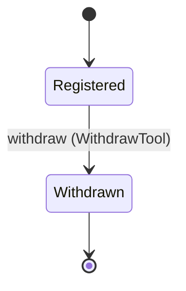

Each move is taken by a declared command outcome, and a move nothing takes is refused as `missing_causation` rather than left as a state change nobody can trigger:

- `withdraw` — taken by `agency.tools.WithdrawTool` on its `withdrawn` outcome

An instance is brought into existence by `agency.tools.RegisterTool` on its `registered` outcome.

Illegal transitions are illegal by absence: no rule forbids them, there is simply no arrow, because a rule would be a second place for the same truth to live. A diagram cannot show an absence, so the pairs it does not connect are listed here, derived from the same transitions — anything named below is a move this specification does not permit.

- `Withdrawn` may not become `Registered`

One view projects it: [`ToolCatalogue`](#toolcatalogue).

### `ToolBinding`

`agency.tools.ToolBinding`.

An instance is identified by `binding_id`, a `agency.tools.BindingId`. The name is part of the model and not a convention: a view projects the identity under that name, so a projection inventing its own would disagree with the view.

It holds:

- `tenant_id` — `agency.auth.TenantId`
- `definition_id` — `Optional<agency.agents.DefinitionId>`, which may be absent
- `team_id` — `Optional<agency.teams.TeamId>`, which may be absent
- `tool_id` — `agency.tools.ToolId`
- `verbs` — `List<agency.shared.Verb>`
- `scope` — `agency.tools.BindingScope`
- `max_output_bytes` — `Integer`
- `expires_at` — `Optional<Timestamp>`, which may be absent
- `credential_id` — `Optional<agency.auth.CredentialId>`, which may be absent

It references at most one [`agency.agents.AgentDefinition`](agency-agents.md#agentdefinition), as `definition`, carried by `ToolBinding.definition_id`. It references at most one [`Tool`](#tool), as `tool`, carried by `ToolBinding.tool_id`. It references at most one [`agency.auth.Credential`](agency-auth.md#credential), as `credential`, carried by `ToolBinding.credential_id`. It references at most one [`agency.teams.Team`](agency-teams.md#team), as `team`, carried by `ToolBinding.team_id`. Its `tenant_id` is what [`agency.auth.Tenant`](agency-auth.md#tenant) owns it by, as `tool_bindings`.

Every instance satisfies `((defined(definition_id) and not (defined(team_id))) or (not (defined(definition_id)) and defined(team_id)))` — a predicate over this entity's own fields, checked against them rather than stored as a sentence, so an invariant reading something the entity does not have is refused instead of documented.

Its state is a `agency.tools.ToolBinding.State`, one of `Granted` and `Revoked`. That enum is synthesised from the lifecycle rather than declared beside it, so the states a view's filter compares and the states drawn below cannot disagree.

An instance is created in `Granted`. `Revoked` is terminal, so an instance may rest there forever. That is declared rather than inferred from having no way out: an entity that cannot leave a state is either finished or stuck, and only its author knows which.

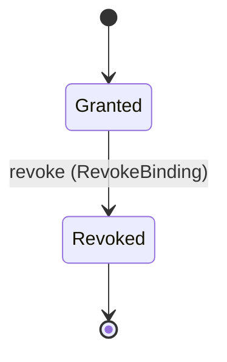

Each move is taken by a declared command outcome, and a move nothing takes is refused as `missing_causation` rather than left as a state change nobody can trigger:

- `revoke` — taken by `agency.tools.RevokeBinding` on its `revoked` outcome

An instance is brought into existence by `agency.tools.BindTool` on its `bound-to-definition` outcome and `agency.tools.BindTool` on its `bound-to-team` outcome.

Illegal transitions are illegal by absence: no rule forbids them, there is simply no arrow, because a rule would be a second place for the same truth to live. A diagram cannot show an absence, so the pairs it does not connect are listed here, derived from the same transitions — anything named below is a move this specification does not permit.

- `Revoked` may not become `Granted`

One view projects it: [`BindingList`](#bindinglist).

## Views

A view is what the outside world is promised it can observe. Each one says which instances it contains and how soon it reflects a command that has already returned, because "you can read this" without "how soon" is the promise every flaky suite is built on.

### `BindingList`

`agency.tools.BindingList`.

It reads [`ToolBinding`](#toolbinding).

It contains every instance of that entity: no filter narrows it, which is a decision somebody made and not a line somebody omitted.

It exposes:

- `binding_id` — `agency.tools.BindingId`
- `tenant_id` — `agency.auth.TenantId`
- `definition_id` — `Optional<agency.agents.DefinitionId>`, which may be absent
- `team_id` — `Optional<agency.teams.TeamId>`, which may be absent
- `tool_id` — `agency.tools.ToolId`
- `verbs` — `List<agency.shared.Verb>`
- `scope` — `agency.tools.BindingScope`
- `max_output_bytes` — `Integer`
- `expires_at` — `Optional<Timestamp>`, which may be absent
- `credential_id` — `Optional<agency.auth.CredentialId>`, which may be absent
- `state` — `agency.tools.ToolBinding.State`

It declares no order, so the rows come back in whatever order the implementation has, and two reads may disagree.

**Read-your-writes**: it is current the moment the command that changed it returns. A caller that has just created an invoice and cannot see it in here has been told a lie about what it did.

A generated scenario asserts it once, immediately after the command: a view promising this and not keeping the promise has to fail the suite rather than be retried until it passes.

### `ToolCatalogue`

`agency.tools.ToolCatalogue`.

It reads [`Tool`](#tool).

It contains every instance of that entity: no filter narrows it, which is a decision somebody made and not a line somebody omitted.

It exposes:

- `tool_id` — `agency.tools.ToolId`
- `tenant_id` — `agency.auth.TenantId`
- `contract_ref` — `agency.tools.ContractRef`
- `verbs` — `List<agency.shared.Verb>`
- `risk` — `agency.tools.RiskEnvelope`
- `implementation_ref` — `Optional<String>`, which may be absent
- `connector_instance_id` — `Optional<String>`, which may be absent
- `state` — `agency.tools.Tool.State`

It declares no order, so the rows come back in whatever order the implementation has, and two reads may disagree.

**Read-your-writes**: it is current the moment the command that changed it returns. A caller that has just created an invoice and cannot see it in here has been told a lie about what it did.

A generated scenario asserts it once, immediately after the command: a view promising this and not keeping the promise has to fail the suite rather than be retried until it passes.

## Commands

### `BindTool`

`agency.tools.BindTool`, shown to a person as "Bind a tool".

It takes:

- `tenant_id` — `agency.auth.TenantId`
- `definition_id` — `Optional<agency.agents.DefinitionId>`, which may be absent
- `team_id` — `Optional<agency.teams.TeamId>`, which may be absent
- `tool_id` — `agency.tools.ToolId`
- `verbs` — `List<agency.shared.Verb>`
- `scope` — `agency.tools.BindingScope`
- `max_output_bytes` — `Integer`
- `expires_at` — `Optional<Timestamp>`, which may be absent
- `credential_id` — `Optional<agency.auth.CredentialId>`, which may be absent

It has three outcomes.

**`bound-to-definition`** — Taken when `(defined(definition_id) and not (defined(team_id)))` holds of the input. It creates a `agency.tools.ToolBinding`, which starts in `Granted`. The new instance's identity is published as `binding_id` on `agency.tools.ToolBound`. It emits `agency.tools.ToolBound`. It sets `tenant_id` from `input.tenant_id`, `definition_id` from `input.definition_id`, `tool_id` from `input.tool_id`, `verbs` from `input.verbs`, `scope` from `input.scope`, `max_output_bytes` from `input.max_output_bytes`, `expires_at` from `input.expires_at` and `credential_id` from `input.credential_id`. A test reaches it by constructing an input that satisfies that condition.

**`bound-to-team`** — Taken when `(not (defined(definition_id)) and defined(team_id))` holds of the input. It creates a `agency.tools.ToolBinding`, which starts in `Granted`. The new instance's identity is published as `binding_id` on `agency.tools.ToolBound`. It emits `agency.tools.ToolBound`. It sets `tenant_id` from `input.tenant_id`, `team_id` from `input.team_id`, `tool_id` from `input.tool_id`, `verbs` from `input.verbs`, `scope` from `input.scope`, `max_output_bytes` from `input.max_output_bytes`, `expires_at` from `input.expires_at` and `credential_id` from `input.credential_id`. A test reaches it by constructing an input that satisfies that condition.

**`target-invalid`** — The default branch, taken when no other outcome's condition matched. No entity in this specification changes. It reports `agency.tools.BindingTargetInvalid`. It emits nothing. A test reaches it by constructing an input that satisfies no other outcome's condition.

### `RegisterTool`

`agency.tools.RegisterTool`, shown to a person as "Register a tool".

It takes:

- `tenant_id` — `agency.auth.TenantId`
- `contract_ref` — `agency.tools.ContractRef`
- `verbs` — `List<agency.shared.Verb>`
- `risk` — `agency.tools.RiskEnvelope`
- `implementation_ref` — `Optional<String>`, which may be absent
- `connector_instance_id` — `Optional<String>`, which may be absent

It has one outcome.

**`registered`** — The default branch, taken when no other outcome's condition matched. It creates a `agency.tools.Tool`, which starts in `Registered`. The new instance's identity is published as `tool_id` on `agency.tools.ToolRegistered`. It emits `agency.tools.ToolRegistered`. It sets `tenant_id` from `input.tenant_id`, `contract_ref` from `input.contract_ref`, `verbs` from `input.verbs`, `risk` from `input.risk`, `implementation_ref` from `input.implementation_ref` and `connector_instance_id` from `input.connector_instance_id`. A test reaches it by constructing an input that satisfies no other outcome's condition.

### `RevokeBinding`

`agency.tools.RevokeBinding`, shown to a person as "Revoke a binding".

It takes:

- `binding_id` — `agency.tools.BindingId`

It has three outcomes.

**`no-such-binding`** — Taken when the identity the command names is one no record carries, before any other answer for it. No entity in this specification changes. It reports `agency.tools.NotFound`. It emits nothing. A test reaches it by sending an identity no record carries, arranging nothing.

**`revoked`** — The default branch, taken when no other outcome's condition matched. It moves a `agency.tools.ToolBinding` from `Granted` to `Revoked`, along the declared move `revoke`. The instance is the one named by the input field `binding_id`. It emits `agency.tools.BindingRevoked`. A test reaches it by constructing an input that satisfies no other outcome's condition.

**`wrong-state`** — Taken when the subject is resting in a state none of this command's moves start from — a `agency.tools.ToolBinding` in `Revoked`, which is what is left of the lifecycle once this command's own moves are taken away. The document lists none of it. No entity in this specification changes. It reports `agency.tools.StateConflict`. It emits nothing. A test reaches it by driving an instance into one of those states and then issuing the command, because no input selects this branch.

### `WithdrawTool`

`agency.tools.WithdrawTool`, shown to a person as "Withdraw a tool".

It takes:

- `tool_id` — `agency.tools.ToolId`

It has three outcomes.

**`no-such-tool`** — Taken when the identity the command names is one no record carries, before any other answer for it. No entity in this specification changes. It reports `agency.tools.NotFound`. It emits nothing. A test reaches it by sending an identity no record carries, arranging nothing.

**`withdrawn`** — The default branch, taken when no other outcome's condition matched. It moves a `agency.tools.Tool` from `Registered` to `Withdrawn`, along the declared move `withdraw`. The instance is the one named by the input field `tool_id`. It emits `agency.tools.ToolWithdrawn`. A test reaches it by constructing an input that satisfies no other outcome's condition.

**`wrong-state`** — Taken when the subject is resting in a state none of this command's moves start from — a `agency.tools.Tool` in `Withdrawn`, which is what is left of the lifecycle once this command's own moves are taken away. The document lists none of it. No entity in this specification changes. It reports `agency.tools.StateConflict`. It emits nothing. A test reaches it by driving an instance into one of those states and then issuing the command, because no input selects this branch.

## Events

### `BindingRevoked`

`agency.tools.BindingRevoked`.

It carries:

- `binding_id` — `agency.tools.BindingId`

Emitted by `agency.tools.RevokeBinding` on its `revoked` outcome.

Nothing in this system reacts to it.

### `ToolBound`

`agency.tools.ToolBound`.

It carries:

- `binding_id` — `agency.tools.BindingId`
- `tool_id` — `agency.tools.ToolId`
- `verbs` — `List<agency.shared.Verb>`

Emitted by `agency.tools.BindTool` on its `bound-to-definition` and `bound-to-team` outcomes.

Nothing in this system reacts to it.

### `ToolRegistered`

`agency.tools.ToolRegistered`.

It carries:

- `tool_id` — `agency.tools.ToolId`
- `contract_ref` — `agency.tools.ContractRef`

Emitted by `agency.tools.RegisterTool` on its `registered` outcome.

Nothing in this system reacts to it.

### `ToolWithdrawn`

`agency.tools.ToolWithdrawn`.

It carries:

- `tool_id` — `agency.tools.ToolId`

Emitted by `agency.tools.WithdrawTool` on its `withdrawn` outcome.

Nothing in this system reacts to it.

## Errors

### `BindingTargetInvalid`

A binding names neither or both of a definition and a team, and nothing changed.

It carries nothing beyond its name, so a caller can tell what went wrong and not which value caused it.

Reported by `agency.tools.BindTool` on its `target-invalid` outcome.

### `NotFound`

The addressed record does not exist, and nothing changed.

It carries nothing beyond its name, so a caller can tell what went wrong and not which value caused it.

Reported by `agency.tools.RevokeBinding` on its `no-such-binding` outcome.

Reported by `agency.tools.WithdrawTool` on its `no-such-tool` outcome.

### `StateConflict`

The addressed record is not in a state this command acts from, and nothing changed.

It carries nothing beyond its name, so a caller can tell what went wrong and not which value caused it.

Reported by `agency.tools.RevokeBinding` on its `wrong-state` outcome.

Reported by `agency.tools.WithdrawTool` on its `wrong-state` outcome.

---

Generated from agency v1 · model digest `71132e90bde806415603d08bb97a71629b2c2f6cda30e1f22e76f407abd9a3eb` · contract digest `slice-sha256/2:c9652dbc5837f2cadeaf219925de817e3912aae234fa51388b67d2ea5da11fe5`. Do not edit this file; change the specification and regenerate it with `ess generate`.

<!--
generated from agency v1
model digest 71132e90bde806415603d08bb97a71629b2c2f6cda30e1f22e76f407abd9a3eb
contract digest slice-sha256/2:c9652dbc5837f2cadeaf219925de817e3912aae234fa51388b67d2ea5da11fe5
do not edit: regenerate with `ess generate`
-->

# Work

The inputs work arrives from, and the work items Agency handles by reference: routed, assigned, run and settled without copying their bodies.

`agency.work` is one of agency's bounded contexts. [Back to the index](../index.md).

## Types

### `AepStoreSource`

`agency.work.AepStoreSource` is a record of two fields:

- `repo` — `String`
- `filter` — `String`

### `GitHubIssuesSource`

`agency.work.GitHubIssuesSource` is a record of two fields:

- `repo` — `String`
- `label` — `String`

### `InputId`

`agency.work.InputId` wraps `Uuid` and is not interchangeable with one: the whole value of naming it separately is the crossings the model then refuses.

### `WebhookSource`

`agency.work.WebhookSource` is a record of one field:

- `secret_ref` — `String`

### `WorkItemRef`

`agency.work.WorkItemRef` wraps `String` and is not interchangeable with one: the whole value of naming it separately is the crossings the model then refuses.

### `WorkSource`

`agency.work.WorkSource` is one of five shapes, told apart by a `kind` field — tagged, so a decoder never has to guess which branch it is reading:

- `A2aTask` — carries nothing; its value is the tag alone
- `AepStore` — `agency.work.AepStoreSource`
- `GitHubIssues` — `agency.work.GitHubIssuesSource`
- `Manual` — carries nothing; its value is the tag alone
- `Webhook` — `agency.work.WebhookSource`

## Entities

An entity is what this context is about: something with an identity that outlives any one request, a shape, and a lifecycle. The lifecycle is exhaustive — a move that is not drawn below is a move this specification does not permit, and that is the only way it says so. Every move is labelled with the command that takes it, because a move nothing can trigger is refused rather than drawn.

### `WorkInput`

`agency.work.WorkInput`.

An instance is identified by `input_id`, a `agency.work.InputId`. The name is part of the model and not a convention: a view projects the identity under that name, so a projection inventing its own would disagree with the view.

It holds:

- `tenant_id` — `agency.auth.TenantId`
- `name` — `String`
- `source` — `agency.work.WorkSource`
- `poll_interval` — `Optional<Duration>`, which may be absent
- `workforce_id` — `agency.teams.WorkforceId`
- `transform_ref` — `Optional<String>`, which may be absent

It references at most one [`agency.teams.Workforce`](agency-teams.md#workforce), as `workforce`, carried by `WorkInput.workforce_id`. Its `tenant_id` is what [`agency.auth.Tenant`](agency-auth.md#tenant) owns it by, as `work_inputs`.

No invariant is declared, so nothing here constrains an instance at rest.

Its state is a `agency.work.WorkInput.State`, one of `Configured`, `Paused` and `Removed`. That enum is synthesised from the lifecycle rather than declared beside it, so the states a view's filter compares and the states drawn below cannot disagree.

An instance is created in `Configured`. `Removed` is terminal, so an instance may rest there forever. That is declared rather than inferred from having no way out: an entity that cannot leave a state is either finished or stuck, and only its author knows which.

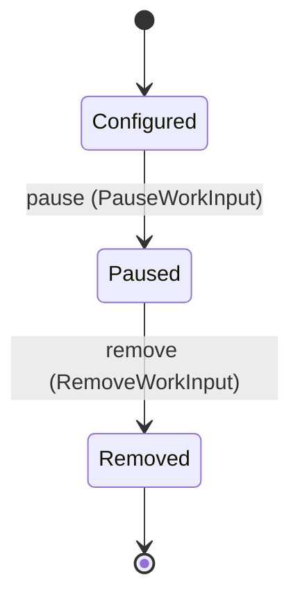

Each move is taken by a declared command outcome, and a move nothing takes is refused as `missing_causation` rather than left as a state change nobody can trigger:

- `pause` — taken by `agency.work.PauseWorkInput` on its `paused` outcome
- `remove` — taken by `agency.work.RemoveWorkInput` on its `removed` outcome

An instance is brought into existence by `agency.work.ConfigureWorkInput` on its `configured` outcome.

Illegal transitions are illegal by absence: no rule forbids them, there is simply no arrow, because a rule would be a second place for the same truth to live. A diagram cannot show an absence, so the pairs it does not connect are listed here, derived from the same transitions — anything named below is a move this specification does not permit.

- `Configured` may not become `Removed`
- `Paused` may not become `Configured`
- `Removed` may not become `Configured`
- `Removed` may not become `Paused`

One view projects it: [`WorkInputList`](#workinputlist).

### `WorkItem`

`agency.work.WorkItem`.

An instance is identified by `item_ref`, a `agency.work.WorkItemRef`. The name is part of the model and not a convention: a view projects the identity under that name, so a projection inventing its own would disagree with the view.

It holds:

- `tenant_id` — `agency.auth.TenantId`
- `input_id` — `agency.work.InputId`
- `title` — `String`
- `payload_digest` — `agency.shared.Digest`
- `assigned_agent_id` — `Optional<agency.agents.AgentId>`, which may be absent
- `received_at` — `Timestamp`
- `settled_at` — `Optional<Timestamp>`, which may be absent

It references at most one [`WorkInput`](#workinput), as `work_input`, carried by `WorkItem.input_id`. It references at most one [`agency.agents.Agent`](agency-agents.md#agent), as `agent`, carried by `WorkItem.assigned_agent_id`. Its `tenant_id` is what [`agency.auth.Tenant`](agency-auth.md#tenant) owns it by, as `work_items`.

No invariant is declared, so nothing here constrains an instance at rest.

Its state is a `agency.work.WorkItem.State`, one of `Abandoned`, `Assigned`, `Done`, `Received` and `Returned`. That enum is synthesised from the lifecycle rather than declared beside it, so the states a view's filter compares and the states drawn below cannot disagree.

An instance is created in `Received`. `Abandoned`, `Done` and `Returned` are terminal, so an instance may rest there forever. That is declared rather than inferred from having no way out: an entity that cannot leave a state is either finished or stuck, and only its author knows which.

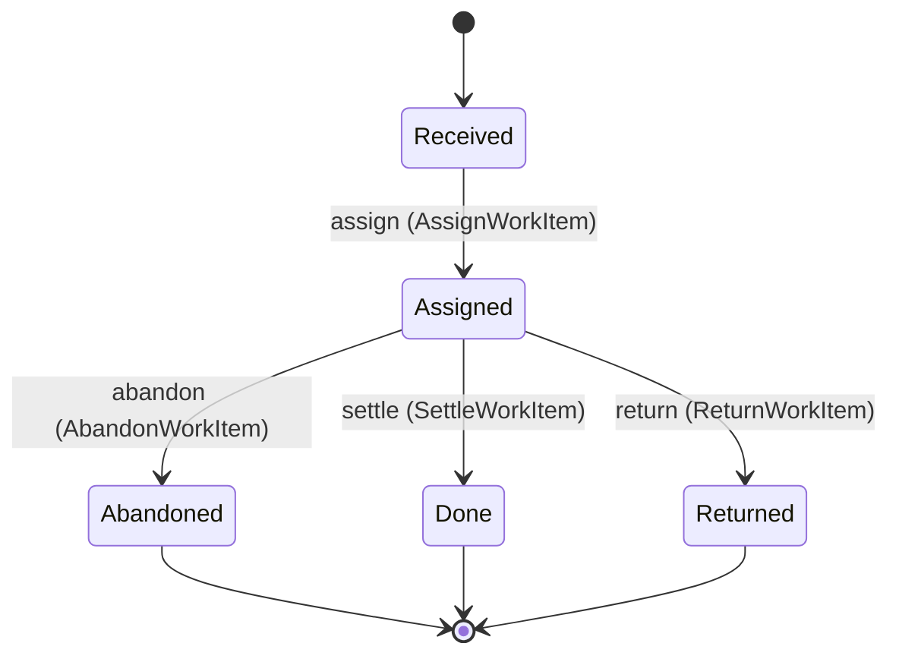

Each move is taken by a declared command outcome, and a move nothing takes is refused as `missing_causation` rather than left as a state change nobody can trigger:

- `assign` — taken by `agency.work.AssignWorkItem` on its `assigned` outcome
- `return` — taken by `agency.work.ReturnWorkItem` on its `returned` outcome
- `settle` — taken by `agency.work.SettleWorkItem` on its `settled` outcome
- `abandon` — taken by `agency.work.AbandonWorkItem` on its `abandoned` outcome

An instance is brought into existence by `agency.work.SubmitWorkItem` on its `received` outcome.

Illegal transitions are illegal by absence: no rule forbids them, there is simply no arrow, because a rule would be a second place for the same truth to live. A diagram cannot show an absence, so the pairs it does not connect are listed here, derived from the same transitions — anything named below is a move this specification does not permit.

- `Abandoned` may not become `Assigned`
- `Abandoned` may not become `Done`
- `Abandoned` may not become `Received`
- `Abandoned` may not become `Returned`
- `Assigned` may not become `Received`
- `Done` may not become `Abandoned`
- `Done` may not become `Assigned`
- `Done` may not become `Received`
- `Done` may not become `Returned`
- `Received` may not become `Abandoned`
- `Received` may not become `Done`
- `Received` may not become `Returned`
- `Returned` may not become `Abandoned`
- `Returned` may not become `Assigned`
- `Returned` may not become `Done`
- `Returned` may not become `Received`

Two views project it: [`WorkItemDetail`](#workitemdetail) and [`WorkQueue`](#workqueue).

## Views

A view is what the outside world is promised it can observe. Each one says which instances it contains and how soon it reflects a command that has already returned, because "you can read this" without "how soon" is the promise every flaky suite is built on.

### `WorkInputList`

`agency.work.WorkInputList`.

It reads [`WorkInput`](#workinput).

It contains every instance of that entity: no filter narrows it, which is a decision somebody made and not a line somebody omitted.

It exposes:

- `input_id` — `agency.work.InputId`
- `tenant_id` — `agency.auth.TenantId`
- `name` — `String`
- `source` — `agency.work.WorkSource`
- `poll_interval` — `Optional<Duration>`, which may be absent
- `workforce_id` — `agency.teams.WorkforceId`
- `transform_ref` — `Optional<String>`, which may be absent
- `state` — `agency.work.WorkInput.State`

It declares no order, so the rows come back in whatever order the implementation has, and two reads may disagree.

**Read-your-writes**: it is current the moment the command that changed it returns. A caller that has just created an invoice and cannot see it in here has been told a lie about what it did.

A generated scenario asserts it once, immediately after the command: a view promising this and not keeping the promise has to fail the suite rather than be retried until it passes.

### `WorkItemDetail`

`agency.work.WorkItemDetail`.

It reads [`WorkItem`](#workitem).

It contains the instances where `item_ref == param.item_ref` holds, and only those — so an instance a caller cannot find in here has been filtered out rather than lost.

It exposes:

- `item_ref` — `agency.work.WorkItemRef`
- `tenant_id` — `agency.auth.TenantId`
- `input_id` — `agency.work.InputId`
- `title` — `String`
- `payload_digest` — `agency.shared.Digest`
- `assigned_agent_id` — `Optional<agency.agents.AgentId>`, which may be absent
- `received_at` — `Timestamp`
- `settled_at` — `Optional<Timestamp>`, which may be absent
- `state` — `agency.work.WorkItem.State`

It declares no order, so the rows come back in whatever order the implementation has, and two reads may disagree.

**Read-your-writes**: it is current the moment the command that changed it returns. A caller that has just created an invoice and cannot see it in here has been told a lie about what it did.

A generated scenario asserts it once, immediately after the command: a view promising this and not keeping the promise has to fail the suite rather than be retried until it passes.

### `WorkQueue`

`agency.work.WorkQueue`.

It reads [`WorkItem`](#workitem).

It contains every instance of that entity: no filter narrows it, which is a decision somebody made and not a line somebody omitted.

It exposes:

- `item_ref` — `agency.work.WorkItemRef`
- `input_id` — `agency.work.InputId`
- `workforce_id` — `Optional<agency.teams.WorkforceId>`, which may be absent
- `title` — `String`
- `assigned_agent_id` — `Optional<agency.agents.AgentId>`, which may be absent
- `received_at` — `Timestamp`
- `state` — `agency.work.WorkItem.State`

It declares no order, so the rows come back in whatever order the implementation has, and two reads may disagree.

**Read-your-writes**: it is current the moment the command that changed it returns. A caller that has just created an invoice and cannot see it in here has been told a lie about what it did.

A generated scenario asserts it once, immediately after the command: a view promising this and not keeping the promise has to fail the suite rather than be retried until it passes.

## Commands

### `AbandonWorkItem`

`agency.work.AbandonWorkItem`, shown to a person as "Abandon a work item".

It takes:

- `item_ref` — `agency.work.WorkItemRef`

It has three outcomes.

**`no-such-item`** — Taken when the identity the command names is one no record carries, before any other answer for it. No entity in this specification changes. It reports `agency.work.NotFound`. It emits nothing. A test reaches it by sending an identity no record carries, arranging nothing.

**`abandoned`** — The default branch, taken when no other outcome's condition matched. It moves a `agency.work.WorkItem` from `Assigned` to `Abandoned`, along the declared move `abandon`. The instance is the one named by the input field `item_ref`. It emits `agency.work.WorkItemAbandoned`. A test reaches it by constructing an input that satisfies no other outcome's condition.

**`wrong-state`** — Taken when the subject is resting in a state none of this command's moves start from — a `agency.work.WorkItem` in `Abandoned`, `Done`, `Received` and `Returned`, which is what is left of the lifecycle once this command's own moves are taken away. The document lists none of it. No entity in this specification changes. It reports `agency.work.StateConflict`. It emits nothing. A test reaches it by driving an instance into one of those states and then issuing the command, because no input selects this branch.

### `AssignWorkItem`

`agency.work.AssignWorkItem`, shown to a person as "Assign a work item".

It takes:

- `item_ref` — `agency.work.WorkItemRef`
- `agent_id` — `agency.agents.AgentId`

It has three outcomes.

**`no-such-item`** — Taken when the identity the command names is one no record carries, before any other answer for it. No entity in this specification changes. It reports `agency.work.NotFound`. It emits nothing. A test reaches it by sending an identity no record carries, arranging nothing.

**`assigned`** — The default branch, taken when no other outcome's condition matched. It moves a `agency.work.WorkItem` from `Received` to `Assigned`, along the declared move `assign`. The instance is the one named by the input field `item_ref`. It emits `agency.work.WorkItemAssigned`. It sets `assigned_agent_id` from `input.agent_id`. A test reaches it by constructing an input that satisfies no other outcome's condition.

**`wrong-state`** — Taken when the subject is resting in a state none of this command's moves start from — a `agency.work.WorkItem` in `Abandoned`, `Assigned`, `Done` and `Returned`, which is what is left of the lifecycle once this command's own moves are taken away. The document lists none of it. No entity in this specification changes. It reports `agency.work.StateConflict`. It emits nothing. A test reaches it by driving an instance into one of those states and then issuing the command, because no input selects this branch.

### `ConfigureWorkInput`

`agency.work.ConfigureWorkInput`, shown to a person as "Configure a work input".

It takes:

- `tenant_id` — `agency.auth.TenantId`
- `name` — `String`
- `source` — `agency.work.WorkSource`
- `poll_interval` — `Optional<Duration>`, which may be absent
- `workforce_id` — `agency.teams.WorkforceId`
- `transform_ref` — `Optional<String>`, which may be absent

It has one outcome.

**`configured`** — The default branch, taken when no other outcome's condition matched. It creates a `agency.work.WorkInput`, which starts in `Configured`. The new instance's identity is published as `input_id` on `agency.work.WorkInputConfigured`. It emits `agency.work.WorkInputConfigured`. It sets `tenant_id` from `input.tenant_id`, `name` from `input.name`, `source` from `input.source`, `poll_interval` from `input.poll_interval`, `workforce_id` from `input.workforce_id` and `transform_ref` from `input.transform_ref`. A test reaches it by constructing an input that satisfies no other outcome's condition.

### `PauseWorkInput`

`agency.work.PauseWorkInput`, shown to a person as "Pause a work input".

It takes:

- `input_id` — `agency.work.InputId`

It has three outcomes.

**`no-such-input`** — Taken when the identity the command names is one no record carries, before any other answer for it. No entity in this specification changes. It reports `agency.work.NotFound`. It emits nothing. A test reaches it by sending an identity no record carries, arranging nothing.

**`paused`** — The default branch, taken when no other outcome's condition matched. It moves a `agency.work.WorkInput` from `Configured` to `Paused`, along the declared move `pause`. The instance is the one named by the input field `input_id`. It emits `agency.work.WorkInputPaused`. A test reaches it by constructing an input that satisfies no other outcome's condition.

**`wrong-state`** — Taken when the subject is resting in a state none of this command's moves start from — a `agency.work.WorkInput` in `Paused` and `Removed`, which is what is left of the lifecycle once this command's own moves are taken away. The document lists none of it. No entity in this specification changes. It reports `agency.work.StateConflict`. It emits nothing. A test reaches it by driving an instance into one of those states and then issuing the command, because no input selects this branch.

### `RemoveWorkInput`

`agency.work.RemoveWorkInput`, shown to a person as "Remove a work input".

It takes:

- `input_id` — `agency.work.InputId`

It has three outcomes.

**`no-such-input`** — Taken when the identity the command names is one no record carries, before any other answer for it. No entity in this specification changes. It reports `agency.work.NotFound`. It emits nothing. A test reaches it by sending an identity no record carries, arranging nothing.

**`removed`** — The default branch, taken when no other outcome's condition matched. It moves a `agency.work.WorkInput` from `Paused` to `Removed`, along the declared move `remove`. The instance is the one named by the input field `input_id`. It emits `agency.work.WorkInputRemoved`. A test reaches it by constructing an input that satisfies no other outcome's condition.

**`wrong-state`** — Taken when the subject is resting in a state none of this command's moves start from — a `agency.work.WorkInput` in `Configured` and `Removed`, which is what is left of the lifecycle once this command's own moves are taken away. The document lists none of it. No entity in this specification changes. It reports `agency.work.StateConflict`. It emits nothing. A test reaches it by driving an instance into one of those states and then issuing the command, because no input selects this branch.

### `ReturnWorkItem`

`agency.work.ReturnWorkItem`, shown to a person as "Return a work item".

It takes:

- `item_ref` — `agency.work.WorkItemRef`

It has three outcomes.

**`no-such-item`** — Taken when the identity the command names is one no record carries, before any other answer for it. No entity in this specification changes. It reports `agency.work.NotFound`. It emits nothing. A test reaches it by sending an identity no record carries, arranging nothing.

**`returned`** — The default branch, taken when no other outcome's condition matched. It moves a `agency.work.WorkItem` from `Assigned` to `Returned`, along the declared move `return`. The instance is the one named by the input field `item_ref`. It emits `agency.work.WorkItemReturned`. A test reaches it by constructing an input that satisfies no other outcome's condition.

**`wrong-state`** — Taken when the subject is resting in a state none of this command's moves start from — a `agency.work.WorkItem` in `Abandoned`, `Done`, `Received` and `Returned`, which is what is left of the lifecycle once this command's own moves are taken away. The document lists none of it. No entity in this specification changes. It reports `agency.work.StateConflict`. It emits nothing. A test reaches it by driving an instance into one of those states and then issuing the command, because no input selects this branch.

### `SettleWorkItem`

`agency.work.SettleWorkItem`, shown to a person as "Settle a work item".

It takes:

- `item_ref` — `agency.work.WorkItemRef`

It has three outcomes.

**`no-such-item`** — Taken when the identity the command names is one no record carries, before any other answer for it. No entity in this specification changes. It reports `agency.work.NotFound`. It emits nothing. A test reaches it by sending an identity no record carries, arranging nothing.

**`settled`** — The default branch, taken when no other outcome's condition matched. It moves a `agency.work.WorkItem` from `Assigned` to `Done`, along the declared move `settle`. The instance is the one named by the input field `item_ref`. It emits `agency.work.WorkItemSettled`. It sets `settled_at` from `implementation-generated`. A test reaches it by constructing an input that satisfies no other outcome's condition.

**`wrong-state`** — Taken when the subject is resting in a state none of this command's moves start from — a `agency.work.WorkItem` in `Abandoned`, `Done`, `Received` and `Returned`, which is what is left of the lifecycle once this command's own moves are taken away. The document lists none of it. No entity in this specification changes. It reports `agency.work.StateConflict`. It emits nothing. A test reaches it by driving an instance into one of those states and then issuing the command, because no input selects this branch.

### `SubmitWorkItem`

`agency.work.SubmitWorkItem`, shown to a person as "Submit a work item".

It takes:

- `tenant_id` — `agency.auth.TenantId`
- `item_ref` — `agency.work.WorkItemRef`
- `input_id` — `agency.work.InputId`
- `title` — `String`
- `payload_digest` — `agency.shared.Digest`

It has one outcome.

**`received`** — The default branch, taken when no other outcome's condition matched. It creates a `agency.work.WorkItem`, which starts in `Received`. The new instance's identity is published as `item_ref` on `agency.work.WorkItemSubmitted`. It emits `agency.work.WorkItemSubmitted`. It sets `tenant_id` from `input.tenant_id`, `input_id` from `input.input_id`, `title` from `input.title`, `payload_digest` from `input.payload_digest` and `received_at` from `implementation-generated`. A test reaches it by constructing an input that satisfies no other outcome's condition.

## Events

### `WorkInputConfigured`

`agency.work.WorkInputConfigured`.

It carries:

- `input_id` — `agency.work.InputId`
- `name` — `String`
- `workforce_id` — `agency.teams.WorkforceId`

Emitted by `agency.work.ConfigureWorkInput` on its `configured` outcome.

Nothing in this system reacts to it.

### `WorkInputPaused`

`agency.work.WorkInputPaused`.

It carries:

- `input_id` — `agency.work.InputId`

Emitted by `agency.work.PauseWorkInput` on its `paused` outcome.

Nothing in this system reacts to it.

### `WorkInputRemoved`

`agency.work.WorkInputRemoved`.

It carries:

- `input_id` — `agency.work.InputId`

Emitted by `agency.work.RemoveWorkInput` on its `removed` outcome.

Nothing in this system reacts to it.

### `WorkItemAbandoned`

`agency.work.WorkItemAbandoned`.

It carries:

- `item_ref` — `agency.work.WorkItemRef`

Emitted by `agency.work.AbandonWorkItem` on its `abandoned` outcome.

Nothing in this system reacts to it.

### `WorkItemAssigned`

`agency.work.WorkItemAssigned`.

It carries:

- `item_ref` — `agency.work.WorkItemRef`
- `agent_id` — `agency.agents.AgentId`

Emitted by `agency.work.AssignWorkItem` on its `assigned` outcome.

Nothing in this system reacts to it.

### `WorkItemReturned`

`agency.work.WorkItemReturned`.

It carries:

- `item_ref` — `agency.work.WorkItemRef`

Emitted by `agency.work.ReturnWorkItem` on its `returned` outcome.

Nothing in this system reacts to it.

### `WorkItemSettled`

`agency.work.WorkItemSettled`.

It carries:

- `item_ref` — `agency.work.WorkItemRef`

Emitted by `agency.work.SettleWorkItem` on its `settled` outcome.

Nothing in this system reacts to it.

### `WorkItemSubmitted`

`agency.work.WorkItemSubmitted`.

It carries:

- `item_ref` — `agency.work.WorkItemRef`
- `input_id` — `agency.work.InputId`
- `payload_digest` — `agency.shared.Digest`

Emitted by `agency.work.SubmitWorkItem` on its `received` outcome.

Nothing in this system reacts to it.

## Errors

### `NotFound`

The addressed record does not exist, and nothing changed.

It carries nothing beyond its name, so a caller can tell what went wrong and not which value caused it.

Reported by `agency.work.AbandonWorkItem` on its `no-such-item` outcome.

Reported by `agency.work.AssignWorkItem` on its `no-such-item` outcome.

Reported by `agency.work.PauseWorkInput` on its `no-such-input` outcome.

Reported by `agency.work.RemoveWorkInput` on its `no-such-input` outcome.

Reported by `agency.work.ReturnWorkItem` on its `no-such-item` outcome.

Reported by `agency.work.SettleWorkItem` on its `no-such-item` outcome.

### `StateConflict`

The addressed record is not in a state this command acts from, and nothing changed.

It carries nothing beyond its name, so a caller can tell what went wrong and not which value caused it.

Reported by `agency.work.AbandonWorkItem` on its `wrong-state` outcome.

Reported by `agency.work.AssignWorkItem` on its `wrong-state` outcome.

Reported by `agency.work.PauseWorkInput` on its `wrong-state` outcome.

Reported by `agency.work.RemoveWorkInput` on its `wrong-state` outcome.

Reported by `agency.work.ReturnWorkItem` on its `wrong-state` outcome.

Reported by `agency.work.SettleWorkItem` on its `wrong-state` outcome.

---

Generated from agency v1 · model digest `71132e90bde806415603d08bb97a71629b2c2f6cda30e1f22e76f407abd9a3eb` · contract digest `slice-sha256/2:c9652dbc5837f2cadeaf219925de817e3912aae234fa51388b67d2ea5da11fe5`. Do not edit this file; change the specification and regenerate it with `ess generate`.
